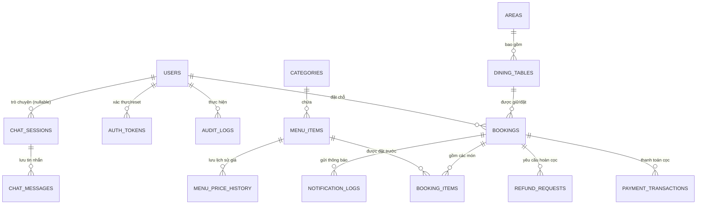

# DATABASE SCHEMA & ERD SPECIFICATION (PostgreSQL)

**Dự án:** Website đặt bàn và đặt món trước cho nhà hàng tích hợp chatbot AI (`QL09-W`)  
**Jira Key:** `SCRUM` (`US-02` / `SCRUM-19`, `SCRUM-20`) | **Database:** PostgreSQL 16+ | **ORM & Migration:** SQLAlchemy 2.0 + Alembic

---

## 1. Phân vùng Sở hữu Schema & Quy tắc Migration Không Conflict

Để **Dev Fullstack** và **Dev AI** phát triển song song mà không đụng độ file model hay Alembic head:

| Phân vùng | File SQLAlchemy Model | Prefix Migration | Người sở hữu (Ghi) | Quyền truy cập chéo |
| :--- | :--- | :--- | :--- | :--- |
| **Core Business Schema** (11 bảng) | `backend/app/models/core_models.py` | `*_core_*.py` | **Dev Fullstack** | **Dev AI** chỉ được `SELECT` (read-only) trên `categories`, `menu_items`, `areas`, `dining_tables`, `business_configs`. Tuyệt đối không `INSERT`/`UPDATE` bảng `bookings`. |
| **AI & Chatbot Schema** (3 bảng) | `backend/app/models/ai_models.py` | `*_ai_*.py` | **Dev AI** | **Dev Fullstack** chỉ đọc qua API/view nếu làm trang Quản trị Chatbot (`US-46`) hoặc Báo cáo mở rộng (`US-47`). |

**Quy tắc chạy Alembic:**
1. Sprint 1: `SCRUM-19` (Dev Fullstack) tạo migration bảng core trước → merge vào `develop` → `SCRUM-20` (Dev AI) rebase `develop` và tạo migration 3 bảng AI nối tiếp.
2. Mọi cột thời gian đều dùng kiểu `TIMESTAMPTZ` chuẩn hóa theo múi giờ Việt Nam (`Asia/Ho_Chi_Minh` / `GMT+7`).
3. Bật extension `btree_gist` và `pgcrypto` ngay trong migration đầu tiên:
   ```sql
   CREATE EXTENSION IF NOT EXISTS btree_gist;
   CREATE EXTENSION IF NOT EXISTS pgcrypto;
   ```

---

## 2. Sơ đồ Quan hệ Thực thể (ERD)



---

## 3. Chi tiết Bảng Phân vùng Core (`backend/app/models/core_models.py`)

### 3.1 `users` – Tài khoản người dùng (`FR-01`, `US-04`, `US-05`, `US-07`)
| Cột | Kiểu dữ liệu | Ràng buộc | Mô tả |
| :--- | :--- | :--- | :--- |
| `id` | `BIGSERIAL` | `PRIMARY KEY` | Khóa chính |
| `full_name` | `VARCHAR(120)` | `NOT NULL` | Họ và tên |
| `phone` | `VARCHAR(20)` | `UNIQUE NOT NULL` | Số điện thoại chuẩn hóa (`0xxxxxxxxx`) |
| `email` | `VARCHAR(150)` | `UNIQUE NOT NULL` | Địa chỉ email |
| `password_hash` | `VARCHAR(255)` | `NOT NULL` | Mật khẩu băm (`bcrypt` / `argon2`) |
| `role` | `VARCHAR(20)` | `NOT NULL DEFAULT 'CUSTOMER'` | `CUSTOMER` \| `STAFF` \| `MANAGER` |
| `is_email_verified` | `BOOLEAN` | `NOT NULL DEFAULT FALSE` | Trạng thái xác thực email (`US-04`) |
| `is_active` | `BOOLEAN` | `NOT NULL DEFAULT TRUE` | Quản lý khóa/mở khóa tài khoản NV (`US-07`) |
| `failed_login_count` | `SMALLINT` | `NOT NULL DEFAULT 0` | Đếm số lần nhập sai mật khẩu liên tiếp (`US-05`) |
| `locked_until` | `TIMESTAMPTZ` | `NULL` | Thời điểm hết khóa (khóa 15 phút khi `failed_login_count >= 5`) |
| `created_at` | `TIMESTAMPTZ` | `NOT NULL DEFAULT NOW()` | Thời điểm tạo |
| `updated_at` | `TIMESTAMPTZ` | `NOT NULL DEFAULT NOW()` | Thời điểm cập nhật |

### 3.2 `auth_tokens` – Token xác thực email & đặt lại mật khẩu (`US-04`, `US-06`)
| Cột | Kiểu dữ liệu | Ràng buộc | Mô tả |
| :--- | :--- | :--- | :--- |
| `id` | `BIGSERIAL` | `PRIMARY KEY` | Khóa chính |
| `user_id` | `BIGINT` | `FK -> users(id) ON DELETE CASCADE` | Chủ sở hữu token |
| `token_hash` | `VARCHAR(128)` | `UNIQUE NOT NULL` | SHA-256 hash của token gửi qua email |
| `purpose` | `VARCHAR(30)` | `NOT NULL` | `EMAIL_VERIFY` \| `PASSWORD_RESET` |
| `expires_at` | `TIMESTAMPTZ` | `NOT NULL` | Thời hạn hiệu lực (vd: 30 phút cho reset mật khẩu) |
| `used_at` | `TIMESTAMPTZ` | `NULL` | Đảm bảo liên kết chỉ dùng 1 lần duy nhất (`US-06`) |
| `created_at` | `TIMESTAMPTZ` | `NOT NULL DEFAULT NOW()` | Thời điểm sinh token |

### 3.3 `audit_logs` – Nhật ký bảo mật & thay đổi vận hành (`US-07`, `US-33`)
| Cột | Kiểu dữ liệu | Ràng buộc | Mô tả |
| :--- | :--- | :--- | :--- |
| `id` | `BIGSERIAL` | `PRIMARY KEY` | Khóa chính |
| `actor_user_id` | `BIGINT` | `FK -> users(id) NULL` | Người thực hiện |
| `action` | `VARCHAR(60)` | `NOT NULL` | `FORBIDDEN_403` \| `BOOKING_TABLE_CHANGE` \| `BOOKING_TIME_CHANGE` \| `STAFF_CANCEL` \| `MANAGER_EXCEPTION_REFUND` |
| `entity_type` | `VARCHAR(40)` | `NOT NULL` | `BOOKING` \| `USER` \| `MENU_ITEM` \| `AUTH` |
| `entity_id` | `VARCHAR(64)` | `NULL` | ID bản ghi tác động |
| `old_value` | `JSONB` | `NULL` | Giá trị cũ trước khi sửa (`US-33`) |
| `new_value` | `JSONB` | `NULL` | Giá trị mới sau khi sửa (`US-33`) |
| `reason` | `TEXT` | `NULL` | Lý do hủy/ngoại lệ hoàn cọc của Quản lý |
| `ip_address` | `VARCHAR(45)` | `NULL` | IP truy cập |
| `created_at` | `TIMESTAMPTZ` | `NOT NULL DEFAULT NOW()` | Thời điểm ghi nhật ký |

### 3.4 `categories` & `menu_items` – Danh mục và Món ăn (`FR-02`, `FR-03`, `US-09`..`US-12`)
**Bảng `categories`:**
| Cột | Kiểu dữ liệu | Ràng buộc | Mô tả |
| :--- | :--- | :--- | :--- |
| `id` | `BIGSERIAL` | `PRIMARY KEY` | Khóa chính |
| `name` | `VARCHAR(100)` | `NOT NULL` | Tên danh mục (Khai vị, Món chính, Lẩu, Đồ uống...) |
| `display_order` | `INT` | `NOT NULL DEFAULT 0` | Thứ tự hiển thị |
| `is_active` | `BOOLEAN` | `NOT NULL DEFAULT TRUE` | Ẩn/hiện danh mục |
| `is_deleted` | `BOOLEAN` | `NOT NULL DEFAULT FALSE` | Xóa mềm (`US-11`) |

**Bảng `menu_items`:**
| Cột | Kiểu dữ liệu | Ràng buộc | Mô tả |
| :--- | :--- | :--- | :--- |
| `id` | `BIGSERIAL` | `PRIMARY KEY` | Khóa chính |
| `category_id` | `BIGINT` | `FK -> categories(id)` | Danh mục món |
| `name` | `VARCHAR(150)` | `NOT NULL` | Tên món ăn (không được rỗng) |
| `description` | `TEXT` | `NULL` | Mô tả thành phần, khẩu phần gợi ý |
| `price_vnd` | `NUMERIC(12,0)` | `NOT NULL CHECK (price_vnd > 0)` | Giá bán hiện hành (VND, > 0) |
| `image_url` | `VARCHAR(500)` | `NULL` | Đường dẫn ảnh món |
| `tags` | `JSONB` | `NOT NULL DEFAULT '[]'` | Mảng nhãn món: `["chay", "cay", "hai_san", "best_seller"]` (`US-10`) |
| `recommended_party_size` | `SMALLINT` | `NULL` | Khẩu phần gợi ý (1, 2, 4, 6 người) hỗ trợ AI tư vấn (`US-30`) |
| `status` | `VARCHAR(20)` | `NOT NULL DEFAULT 'AVAILABLE'` | `AVAILABLE` (Đang bán) \| `OUT_OF_STOCK` (Tạm hết) \| `DISCONTINUED` (Ngừng bán) (`US-12`) |
| `is_deleted` | `BOOLEAN` | `NOT NULL DEFAULT FALSE` | Xóa mềm; chặn xóa nếu đã từng phát sinh trong `booking_items` (`US-11`) |
| `created_at` | `TIMESTAMPTZ` | `NOT NULL DEFAULT NOW()` | Thời điểm tạo |
| `updated_at` | `TIMESTAMPTZ` | `NOT NULL DEFAULT NOW()` | Thời điểm cập nhật |

*Index:* `CREATE INDEX idx_menu_items_active_search ON menu_items(category_id, status, price_vnd) WHERE is_deleted = FALSE;` và GIN index trên `tags`.

### 3.5 `menu_price_history` – Lịch sử đổi giá món (`US-12`)
| Cột | Kiểu dữ liệu | Ràng buộc | Mô tả |
| :--- | :--- | :--- | :--- |
| `id` | `BIGSERIAL` | `PRIMARY KEY` | Khóa chính |
| `menu_item_id` | `BIGINT` | `FK -> menu_items(id)` | Món ăn thay đổi giá |
| `old_price_vnd` | `NUMERIC(12,0)` | `NOT NULL` | Giá cũ trước khi sửa |
| `new_price_vnd` | `NUMERIC(12,0)` | `NOT NULL` | Giá mới |
| `changed_by` | `BIGINT` | `FK -> users(id)` | Quản lý thực hiện đổi giá |
| `changed_at` | `TIMESTAMPTZ` | `NOT NULL DEFAULT NOW()` | Thời điểm đổi giá |

### 3.6 `areas` & `dining_tables` – Khu vực và Sơ đồ bàn (`FR-04`, `US-13`, `US-14`)
**Bảng `areas`:**
| Cột | Kiểu dữ liệu | Ràng buộc | Mô tả |
| :--- | :--- | :--- | :--- |
| `id` | `BIGSERIAL` | `PRIMARY KEY` | Khóa chính |
| `name` | `VARCHAR(100)` | `UNIQUE NOT NULL` | Tên khu vực (Tầng 1, Sân vườn, Phòng VIP...) |
| `description` | `VARCHAR(255)` | `NULL` | Mô tả không gian |
| `is_active` | `BOOLEAN` | `NOT NULL DEFAULT TRUE` | Trạng thái khu vực |

**Bảng `dining_tables`:**
| Cột | Kiểu dữ liệu | Ràng buộc | Mô tả |
| :--- | :--- | :--- | :--- |
| `id` | `BIGSERIAL` | `PRIMARY KEY` | Khóa chính |
| `area_id` | `BIGINT` | `FK -> areas(id)` | Khu vực chứa bàn |
| `table_code` | `VARCHAR(30)` | `UNIQUE NOT NULL` | Mã bàn duy nhất (vd: `T1-01`, `SV-02`, `VIP-01`) |
| `capacity` | `SMALLINT` | `NOT NULL CHECK (capacity >= 1)` | Sức chứa tối thiểu là 1 (`FR-04`) |
| `is_combinable` | `BOOLEAN` | `NOT NULL DEFAULT FALSE` | Đánh dấu bàn có thể ghép (`US-13`) |
| `pos_x` | `INT` | `NOT NULL DEFAULT 0` | Tọa độ X trên sơ đồ bàn kéo thả (`US-14`) |
| `pos_y` | `INT` | `NOT NULL DEFAULT 0` | Tọa độ Y trên sơ đồ bàn kéo thả (`US-14`) |
| `status` | `VARCHAR(20)` | `NOT NULL DEFAULT 'ACTIVE'` | `ACTIVE` (Hoạt động) \| `INACTIVE` (Ngưng sử dụng) |

### 3.7 `business_configs` – Tham số nghiệp vụ cấu hình động (`US-20`)
Lưu 1 dòng cấu hình hiện hành (hoặc key-value có version) với giá trị mặc định chuẩn SRS:
| Cột | Kiểu dữ liệu | Mặc định chuẩn SRS | Ý nghĩa |
| :--- | :--- | :--- | :--- |
| `id` | `SMALLINT` | `1 (PRIMARY KEY)` | Bản ghi cấu hình |
| `open_time` | `TIME` | `'10:00:00'` | Giờ mở cửa (dùng tính đơn đặt ngoài giờ làm việc `FR-12`) |
| `close_time` | `TIME` | `'22:00:00'` | Giờ đóng cửa |
| `slot_step_minutes` | `SMALLINT` | `30` | Bước chia khung giờ đặt bàn (30 phút) |
| `service_duration_minutes` | `SMALLINT` | `90` | Thời lượng mỗi lượt phục vụ (90 phút) |
| `min_advance_hours` | `SMALLINT` | `2` | Đặt trước tối thiểu 2 giờ so với giờ hẹn |
| `max_advance_days` | `SMALLINT` | `30` | Đặt trước tối đa 30 ngày |
| `hold_timeout_minutes` | `SMALLINT` | `10` | Thời gian giữ chỗ tạm thời chờ cọc (10 phút) |
| `deposit_percent_preorder` | `SMALLINT` | `30` | Mức cọc % tổng giá trị món đặt trước (30%) |
| `deposit_per_guest_no_food` | `NUMERIC(12,0)` | `50000` | Mức cọc cố định/khách khi chỉ đặt bàn không đặt món |
| `edit_food_deadline_hours` | `SMALLINT` | `2` | Hạn chót sửa/hủy món trước giờ hẹn (2 giờ) |
| `max_qty_per_item` | `SMALLINT` | `20` | Số lượng tối đa mỗi món trong giỏ (20) |
| `refund_100_Threshold_hours` | `SMALLINT` | `24` | Hủy trước ≥ 24 giờ hoàn 100% cọc |
| `refund_50_threshold_hours` | `SMALLINT` | `2` | Hủy từ 2 đến < 24 giờ hoàn 50% cọc (< 2 giờ hoàn 0%) |
| `late_checkin_grace_minutes` | `SMALLINT` | `15` | Quá giờ hẹn 15 phút chưa check-in thì nhắc nhân viên |
| `reminder_first_hours` | `SMALLINT` | `24` | Nhắc lịch lần 1 trước 24 giờ |
| `reminder_second_hours` | `SMALLINT` | `2` | Nhắc lịch lần 2 trước 2 giờ |
| `enable_sms_reminder_2h` | `BOOLEAN` | `FALSE` | Bật/tắt gửi SMS cho mốc nhắc 2 giờ |
| `updated_by` | `BIGINT` | `FK -> users(id) NULL` | Quản lý cập nhật gần nhất |
| `updated_at` | `TIMESTAMPTZ` | `NOW()` | Thời điểm cập nhật (chỉ áp dụng cho đơn tạo mới sau thời điểm này) |

### 3.8 `bookings` – Đơn đặt chỗ & Ràng buộc chống trùng bàn (`FR-05`, `US-18`)
| Cột | Kiểu dữ liệu | Ràng buộc | Mô tả |
| :--- | :--- | :--- | :--- |
| `id` | `BIGSERIAL` | `PRIMARY KEY` | Khóa chính |
| `booking_code` | `VARCHAR(24)` | `UNIQUE NOT NULL` | Mã đặt chỗ (vd: `RES-261117-A8F2`) |
| `customer_id` | `BIGINT` | `FK -> users(id) NOT NULL` | Khách hàng đặt bàn |
| `table_id` | `BIGINT` | `FK -> dining_tables(id) NOT NULL` | Bàn được giữ/đặt |
| `guest_count` | `SMALLINT` | `NOT NULL CHECK (guest_count >= 1)` | Số lượng khách |
| `booking_date` | `DATE` | `NOT NULL` | Ngày hẹn (theo `GMT+7`) |
| `start_at` | `TIMESTAMPTZ` | `NOT NULL` | Thời điểm bắt đầu khung giờ hẹn (`GMT+7`) |
| `end_at` | `TIMESTAMPTZ` | `NOT NULL` | Thời điểm kết thúc lượt ăn (`start_at + service_duration_minutes`) |
| `slot_range` | `TSTZRANGE` | `GENERATED ALWAYS AS (tstzrange(start_at, end_at, '[)')) STORED` | Khoảng thời gian chiếm bàn `[start_at, end_at)` |
| `status` | `VARCHAR(25)` | `NOT NULL DEFAULT 'PENDING_DEPOSIT'` | 7 trạng thái vòng đời (xem bảng dưới) |
| `hold_expires_at` | `TIMESTAMPTZ` | `NOT NULL` | Thời điểm hết hạn giữ chỗ 10 phút (`start_hold + 10m`) |
| `food_subtotal_vnd` | `NUMERIC(12,0)` | `NOT NULL DEFAULT 0` | Tổng tiền món đặt trước theo giá chốt |
| `deposit_required_vnd` | `NUMERIC(12,0)` | `NOT NULL DEFAULT 0` | Số tiền cọc yêu cầu |
| `deposit_paid_vnd` | `NUMERIC(12,0)` | `NOT NULL DEFAULT 0` | Số tiền cọc đã thanh toán thành công |
| `applied_config_snapshot` | `JSONB` | `NOT NULL` | Lưu snapshot tham số `business_configs` lúc tạo đơn (`US-20`) |
| `customer_note` | `TEXT` | `NULL` | Ghi chú của khách (sinh nhật, ghế trẻ em...) |
| `is_outside_business_hours` | `BOOLEAN` | `NOT NULL DEFAULT FALSE` | Tự động gán `TRUE` nếu `created_at` nằm ngoài `open_time..close_time` (phục vụ KPI `FR-12`) |
| `source` | `VARCHAR(20)` | `NOT NULL DEFAULT 'WEB'` | `WEB` \| `CHATBOT` \| `PHONE` (`US-50`) |
| `checked_in_at` | `TIMESTAMPTZ` | `NULL` | Thời điểm khách check-in (`US-32`) |
| `completed_at` | `TIMESTAMPTZ` | `NULL` | Thời điểm hoàn thành đơn |
| `cancelled_at` | `TIMESTAMPTZ` | `NULL` | Thời điểm hủy đơn |
| `cancel_reason` | `TEXT` | `NULL` | Lý do hủy |
| `created_at` | `TIMESTAMPTZ` | `NOT NULL DEFAULT NOW()` | Thời điểm tạo đơn |
| `updated_at` | `TIMESTAMPTZ` | `NOT NULL DEFAULT NOW()` | Thời điểm cập nhật |

**7 trạng thái chuẩn của `bookings.status` (khớp SRS mục 2.1.4):**
- `PENDING_DEPOSIT` (Chờ cọc)
- `CONFIRMED` (Đã xác nhận)
- `CHECKED_IN` (Đã đến)
- `COMPLETED` (Hoàn thành – trạng thái cuối)
- `CANCELLED` (Đã hủy – trạng thái cuối)
- `NO_SHOW` (Không đến – trạng thái cuối)
- `EXPIRED` (Hết hạn – trạng thái cuối)

**Ràng buộc CSDL chống trùng bàn tuyệt đối (`US-18`):**
```sql
ALTER TABLE bookings
ADD CONSTRAINT excl_bookings_no_double_booking
EXCLUDE USING gist (
    table_id WITH =,
    slot_range WITH &&
)
WHERE (status IN ('PENDING_DEPOSIT', 'CONFIRMED', 'CHECKED_IN'));
```
> Nhờ `EXCLUDE USING gist`, ngay cả khi 2 khách bấm giữ cùng 1 bàn và khung giờ trùng nhau ở cùng một mili-giây, PostgreSQL sẽ chỉ cho phép 1 transaction commit thành công và tự động ném lỗi `ExclusionViolation` (`SQLSTATE 23P01`) cho request thứ hai (Backend bắt lỗi này trả `409 Conflict`).

### 3.9 `booking_items` – Chi tiết giỏ món đặt trước (`FR-06`, `US-21`, `US-22`)
| Cột | Kiểu dữ liệu | Ràng buộc | Mô tả |
| :--- | :--- | :--- | :--- |
| `id` | `BIGSERIAL` | `PRIMARY KEY` | Khóa chính |
| `booking_id` | `BIGINT` | `FK -> bookings(id) ON DELETE CASCADE` | Đơn đặt chỗ |
| `menu_item_id` | `BIGINT` | `FK -> menu_items(id)` | Món ăn |
| `quantity` | `SMALLINT` | `NOT NULL CHECK (quantity BETWEEN 1 AND 20)` | Số lượng (1..20) |
| `unit_price_locked` | `NUMERIC(12,0)` | `NOT NULL` | Giá chốt của món tại thời điểm xác nhận (`US-22`) |
| `item_note` | `VARCHAR(255)` | `NULL` | Ghi chú riêng từng món (ít cay, không hành...) |
| `is_affected_by_out_of_stock` | `BOOLEAN` | `NOT NULL DEFAULT FALSE` | Đánh dấu cảnh báo khi món chuyển hết/ngừng bán (`US-49`) |

*Constraint:* `UNIQUE (booking_id, menu_item_id, COALESCE(item_note, ''))`.

### 3.10 `payment_transactions` & `refund_requests` – Giao dịch cọc & Hoàn cọc (`FR-07`, `FR-09`, `US-24`..`US-26`)
**Bảng `payment_transactions` (Tuyệt đối không có cột lưu số thẻ):**
| Cột | Kiểu dữ liệu | Ràng buộc | Mô tả |
| :--- | :--- | :--- | :--- |
| `id` | `BIGSERIAL` | `PRIMARY KEY` | Khóa chính |
| `booking_id` | `BIGINT` | `FK -> bookings(id)` | Đơn đặt chỗ |
| `txn_ref` | `VARCHAR(64)` | `UNIQUE NOT NULL` | Mã giao dịch phía hệ thống nhà hàng |
| `provider_txn_id` | `VARCHAR(100)` | `UNIQUE NULL` | Mã giao dịch từ cổng thanh toán (UNIQUE để chống xử lý callback trùng `US-25`) |
| `provider` | `VARCHAR(30)` | `NOT NULL DEFAULT 'SANDBOX'` | Tên cổng thanh toán sandbox |
| `amount_vnd` | `NUMERIC(12,0)` | `NOT NULL` | Số tiền giao dịch |
| `status` | `VARCHAR(25)` | `NOT NULL DEFAULT 'INITIATED'` | `INITIATED` \| `SUCCESS` \| `FAILED` \| `LATE_SUCCESS_REFUND_NEEDED` |
| `signature_verified` | `BOOLEAN` | `NOT NULL DEFAULT FALSE` | Đã xác thực chữ ký HMAC của callback |
| `callback_received_at` | `TIMESTAMPTZ` | `NULL` | Thời điểm nhận callback |
| `created_at` | `TIMESTAMPTZ` | `NOT NULL DEFAULT NOW()` | Thời điểm tạo giao dịch |

**Bảng `refund_requests`:**
| Cột | Kiểu dữ liệu | Ràng buộc | Mô tả |
| :--- | :--- | :--- | :--- |
| `id` | `BIGSERIAL` | `PRIMARY KEY` | Khóa chính |
| `booking_id` | `BIGINT` | `FK -> bookings(id) UNIQUE` | Đơn hủy yêu cầu hoàn cọc |
| `refund_percent` | `SMALLINT` | `NOT NULL` | `100` \| `50` \| `0` (hoặc ngoại lệ Quản lý) |
| `refund_amount_vnd` | `NUMERIC(12,0)` | `NOT NULL` | Số tiền cần hoàn |
| `status` | `VARCHAR(30)` | `NOT NULL DEFAULT 'PENDING_MANUAL'` | `PENDING_MANUAL` \| `COMPLETED` \| `REJECTED` |
| `processed_by` | `BIGINT` | `FK -> users(id) NULL` | Quản lý xử lý hoàn cọc |
| `processed_note` | `TEXT` | `NULL` | Ghi chú xử lý |
| `created_at` | `TIMESTAMPTZ` | `NOT NULL DEFAULT NOW()` | Thời điểm tạo yêu cầu |
| `processed_at` | `TIMESTAMPTZ` | `NULL` | Thời điểm hoàn tất |

### 3.11 `notification_logs` – Nhật ký gửi Email / SMS & Nhắc lịch (`FR-10`, `US-27`, `US-38`)
| Cột | Kiểu dữ liệu | Ràng buộc | Mô tả |
| :--- | :--- | :--- | :--- |
| `id` | `BIGSERIAL` | `PRIMARY KEY` | Khóa chính |
| `booking_id` | `BIGINT` | `FK -> bookings(id) ON DELETE CASCADE` | Đơn liên quan |
| `event_type` | `VARCHAR(40)` | `NOT NULL` | `DEPOSIT_CONFIRMED` \| `BOOKING_CANCELLED` \| `BOOKING_MODIFIED` \| `REMINDER_24H` \| `REMINDER_2H` |
| `channel` | `VARCHAR(15)` | `NOT NULL DEFAULT 'EMAIL'` | `EMAIL` \| `SMS` |
| `recipient` | `VARCHAR(150)` | `NOT NULL` | Email hoặc SĐT nhận |
| `status` | `VARCHAR(20)` | `NOT NULL DEFAULT 'PENDING'` | `PENDING` \| `SENT` \| `FAILED` |
| `retry_count` | `SMALLINT` | `NOT NULL DEFAULT 0 CHECK (retry_count <= 3)` | Số lần thử lại (tối đa 3 lần `US-27`, `US-38`) |
| `last_error` | `TEXT` | `NULL` | Thông báo lỗi nếu gửi thất bại |
| `sent_at` | `TIMESTAMPTZ` | `NULL` | Thời điểm gửi thành công |
| `created_at` | `TIMESTAMPTZ` | `NOT NULL DEFAULT NOW()` | Thời điểm tạo |

*Constraint chống gửi nhắc lịch trùng:* `UNIQUE (booking_id, event_type, channel)`.

---

## 4. Chi tiết Bảng Phân vùng AI (`backend/app/models/ai_models.py`)

### 4.1 `knowledge_docs` – Kho tri thức tĩnh của nhà hàng (`FR-13`, `FR-15`, `US-16`, `US-30`)
| Cột | Kiểu dữ liệu | Ràng buộc | Mô tả |
| :--- | :--- | :--- | :--- |
| `id` | `BIGSERIAL` | `PRIMARY KEY` | Khóa chính |
| `doc_key` | `VARCHAR(80)` | `UNIQUE NOT NULL` | Mã định danh (vd: `OPENING_HOURS`, `DEPOSIT_POLICY`, `CANCEL_POLICY`, `FAQ_PARKING`) |
| `category` | `VARCHAR(30)` | `NOT NULL` | `RESTAURANT_INFO` \| `POLICY` \| `FAQ` |
| `title` | `VARCHAR(200)` | `NOT NULL` | Câu hỏi / Tiêu đề mục thông tin |
| `content` | `TEXT` | `NOT NULL` | Nội dung chuẩn đã được BA/nhà hàng xác nhận |
| `keywords` | `JSONB` | `NOT NULL DEFAULT '[]'` | Danh sách từ khóa tiếng Việt hỗ trợ truy xuất nhanh |
| `is_active` | `BOOLEAN` | `NOT NULL DEFAULT TRUE` | Bật/tắt sử dụng trong RAG |
| `updated_by` | `BIGINT` | `NULL` | Quản lý cập nhật (`US-46`) |
| `updated_at` | `TIMESTAMPTZ` | `NOT NULL DEFAULT NOW()` | Thời điểm cập nhật |

### 4.2 `chat_sessions` – Phiên hội thoại Chatbot (`FR-13`, `FR-14`, `US-29`, `US-35`)
| Cột | Kiểu dữ liệu | Ràng buộc | Mô tả |
| :--- | :--- | :--- | :--- |
| `id` | `UUID` | `PRIMARY KEY DEFAULT gen_random_uuid()` | Session ID (lưu ở `localStorage` của trình duyệt khách) |
| `user_id` | `BIGINT` | `FK -> users(id) NULL` | `NULL` nếu khách vãng lai; cập nhật khi khách đăng nhập |
| `slot_state_json` | `JSONB` | `NOT NULL DEFAULT '{}'` | Trạng thái thu thập thông tin đặt bàn: `{"date": "2026-11-20", "time": "19:00", "guests": 4, "area_id": 2}` (`US-35`) |
| `needs_human_handoff` | `BOOLEAN` | `NOT NULL DEFAULT FALSE` | Đánh dấu hội thoại cần chuyển nhân viên (`FR-12`, `FR-15`) |
| `created_at` | `TIMESTAMPTZ` | `NOT NULL DEFAULT NOW()` | Thời điểm bắt đầu phiên |
| `updated_at` | `TIMESTAMPTZ` | `NOT NULL DEFAULT NOW()` | Lần tương tác cuối |
| `expires_at` | `TIMESTAMPTZ` | `NOT NULL DEFAULT (NOW() + INTERVAL '90 days')` | Tự động hết hạn sau 90 ngày theo quy định SRS mục 2.8 (`FR-15`) |

### 4.3 `chat_messages` – Tin nhắn hội thoại đã ẩn danh PII (`US-29`, `US-30`, `US-34`)
| Cột | Kiểu dữ liệu | Ràng buộc | Mô tả |
| :--- | :--- | :--- | :--- |
| `id` | `BIGSERIAL` | `PRIMARY KEY` | Khóa chính |
| `session_id` | `UUID` | `FK -> chat_sessions(id) ON DELETE CASCADE` | Thuộc phiên hội thoại |
| `role` | `VARCHAR(15)` | `NOT NULL` | `user` \| `assistant` |
| `content_masked` | `TEXT` | `NOT NULL` | Nội dung tin nhắn **đã qua PII Masker** (tên/SĐT/email bị thay bằng `[NAME]`, `[PHONE]`, `[EMAIL]`) |
| `intent` | `VARCHAR(40)` | `NULL` | `menu_recommend` \| `policy_qa` \| `booking_assist` \| `allergy_medical` \| `out_of_scope` \| `fallback` |
| `recommended_item_ids` | `JSONB` | `NOT NULL DEFAULT '[]'` | Danh sách `menu_item.id` được đính kèm thẻ món (`US-30`) |
| `booking_prefill_url` | `VARCHAR(500)` | `NULL` | Đường dẫn đặt bàn điền sẵn thông tin nếu có (`US-35`) |
| `feedback` | `VARCHAR(15)` | `NULL` | `HELPFUL` \| `NOT_HELPFUL` \| `NULL` (`FR-13`) |
| `is_flagged_incorrect` | `BOOLEAN` | `NOT NULL DEFAULT FALSE` | Quản lý đánh dấu câu trả lời sai (`US-46`) |
| `admin_note` | `TEXT` | `NULL` | Ghi chú chỉnh kịch bản của Quản lý (`US-46`) |
| `latency_ms` | `INT` | `NULL` | Thời gian phản hồi của Ollama (ms) |
| `created_at` | `TIMESTAMPTZ` | `NOT NULL DEFAULT NOW()` | Thời điểm gửi |
