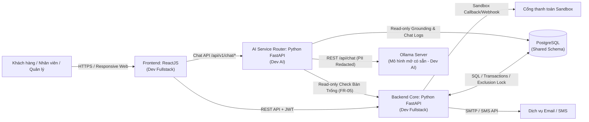

# PROJECT ROADMAP & PHÂN CÔNG CÔNG VIỆC (8 TUẦN)

**Dự án:** Website đặt bàn và đặt món trước cho nhà hàng tích hợp chatbot AI  
**Mã đề tài:** QL09-W | **Phiên bản:** 1.0 | **Ngày lập:** 17/11/2026

| Thông tin | Nội dung |
| :--- | :--- |
| **Tên dự án** | Website đặt bàn và đặt món trước cho nhà hàng tích hợp chatbot AI |
| **Mã đề tài** | QL09-W |
| **Phiên bản Roadmap** | 1.0 (Điều chỉnh theo cơ cấu 4 thành viên & Tech Stack chuẩn) |
| **Ngày lập** | 17/11/2026 |
| **Tài liệu đầu vào** | `Software Requirements Specification (SRS) v1.0`; `Product Backlog v1.0` |
| **Người lập & điều phối** | Project Manager (PM) |
| **Nhân sự thực hiện (4 người)** | PM (1), BA (1), Dev Fullstack (1), Dev AI (1) |
| **Tech Stack chính** | **Frontend:** ReactJS · **Backend:** Python FastAPI · **Database:** PostgreSQL · **Chatbot AI:** Ollama (mô hình có sẵn) |
| **Công cụ quản lý** | Jira (Scrum, khóa `SCRUM`), GitHub (`main` / `develop` / `feature`), Microsoft Project |
| **Phạm vi thời gian** | 8 tuần: Sprint 0 (Khởi động) → Sprint 7 (Phát hành `v1.0` và kết thúc dự án) |

---

## 1. Tổng quan Dự án, Tech Stack & Cơ cấu Nhân sự

### 1.1 Mục tiêu sản phẩm & Chỉ số đo lường (Product Goal & KPIs)
- **Product Goal:** Cho phép khách hàng đặt bàn theo khung giờ, đặt món trước và đặt cọc trực tuyến 24/7 trên website, đồng thời được Chatbot AI tư vấn món và hỗ trợ đặt bàn dựa trên dữ liệu thật của nhà hàng; giúp nhà hàng sắp xếp bàn, chuẩn bị bếp chính xác và giảm thiểu tình trạng khách đặt nhưng không đến (no-show).
- **Chỉ số đo lường cốt lõi (FR-12):**
  1. **Nhận đặt bàn 24/7:** Đo bằng số đơn đặt chỗ được tạo ngoài giờ làm việc của nhà hàng.
  2. **Giảm tỷ lệ không đến (No-show):** Đo bằng tỷ lệ `Số đơn Không đến / Tổng số đơn Đã xác nhận đã qua giờ hẹn` nhờ cơ chế đặt cọc (`FR-07`) và nhắc lịch (`FR-10`).

### 1.2 Kiến trúc kỹ thuật & Ranh giới sở hữu theo Tech Stack



| Thành phần | Công nghệ sử dụng | Người phụ trách | Phạm vi kỹ thuật cốt lõi |
| :--- | :--- | :--- | :--- |
| **Frontend** | **ReactJS** (Vite, TypeScript/JS, React Router, Tailwind CSS + UI library) | **Dev Fullstack** | Giao diện responsive cho 3 vai trò (Khách, Nhân viên, Quản lý); form đặt bàn đếm ngược 10 phút; giỏ món đặt trước; thanh toán cọc; sơ đồ bàn; dashboard báo cáo; khung Chat AI Widget kết nối API của Dev AI. |
| **Backend Core** | **Python FastAPI** (Pydantic, SQLAlchemy/SQLModel, Alembic, APScheduler) | **Dev Fullstack** | Auth/JWT/RBAC 3 vai trò; REST API thực đơn, bàn, đặt bàn, đặt món, vận hành đơn, bếp, báo cáo; khóa giao dịch chống trùng bàn; tích hợp thanh toán sandbox & webhook idempotent; job nền hết hạn cọc (10p) và nhắc lịch (24h/2h). |
| **Database** | **PostgreSQL** | **Dev Fullstack** (chủ trì core) + **Dev AI** (bảng AI/Chat) | Thiết kế ERD & Alembic migration; ràng buộc chống trùng bàn tầng DB (`btree_gist` exclusion / `SELECT FOR UPDATE`); lưu giá chốt món; lịch sử thay đổi giá/đơn; bảng tri thức (`knowledge_docs`) và lịch sử hội thoại (`chat_sessions`, `chat_messages`). |
| **Chatbot AI** | **Ollama** (mô hình mở có sẵn, không huấn luyện lại) + **FastAPI AI Router** | **Dev AI** | Benchmark & chọn model Ollama tiếng Việt tốt (vd `qwen2.5:7b` / `llama3.1:8b`); RAG/truy xuất dữ liệu thật từ PostgreSQL; prompt chống ảo giác; trích xuất thực thể & chuẩn hóa thời gian `GMT+7`; slot-filling đặt bàn qua chat; PII redaction & Guardrails; bộ kiểm thử AI ≥ 30 câu hỏi. |
| **Hạ tầng & CI/CD** | **Docker Compose**, **GitHub Actions** | **Dev Fullstack** + **Dev AI** (container Ollama) | CI tự động lint, pytest và build React khi tạo PR; môi trường Staging deploy tự động từ nhánh `develop`; sao lưu & phát hành Production `v1.0`. |

### 1.3 Cơ cấu nhóm 4 thành viên & Bù đắp vai trò so với Product Backlog gốc

Tài liệu `Product Backlog v1.0` ban đầu thiết kế cho nhóm 5 người (`TV1`–`TV5`). Khi vận hành với cơ cấu thực tế **4 thành viên (PM, BA, Dev Fullstack, Dev AI)**, nhiệm vụ được điều phối lại để vừa giữ nguyên toàn bộ **45 Story MVP (202 SP)** và **6 mốc kiểm tra (M1–M6)**, vừa đảm bảo **Dev AI chạy song song ngay từ Sprint 0–1** (không dồn ứ vào Sprint 5–6) và **không để thiếu vai trò UI/UX hay QA**:

| Thành viên | Vai trò trong Roadmap | Ánh xạ từ Backlog gốc | Trách nhiệm chính | Chiến lược bù đắp khoảng trống (không có UI/UX & QA riêng) |
| :--- | :--- | :--- | :--- | :--- |
| **PM (Bạn)** | Project Manager / Scrum Master | `TV2` + một phần điều phối chất lượng của `TV5` | Quản trị Jira (`SCRUM`), MS Project (WBS, Baseline M2, EVM), quản lý rủi ro & Change Request (CCB), điều phối sự kiện Scrum, kiểm tra DoD trước Review, báo cáo GV & đối tác. | Trực tiếp giám sát chất lượng giao hàng (Definition of Done), quản lý chặt ưu tiên `Must`/`Should` để bảo vệ Dev Fullstack khỏi quá tải. |
| **BA** | Business Analyst / Product Owner | `TV1` + thiết kế luồng màn hình (`TV3`) + nghiệm thu/UAT (`TV5`) | Khảo sát nhà hàng, quản lý Product Backlog, viết User Story & AC, làm mịn backlog, chuẩn bị dữ liệu mẫu ẩn danh (`US-16`), thiết kế wireframe, test nghiệp vụ & dẫn dắt UAT (`US-41`), viết HDSD (`US-43`). | Vẽ wireframe luồng chính (`US-03`) thay cho UI/UX Designer (kết hợp UI kit có sẵn bên ReactJS); trực tiếp viết kịch bản test nghiệp vụ, test đồng thời và UAT thay cho QA chuyên trách. |
| **Dev Fullstack** | Fullstack Developer (ReactJS + FastAPI + PostgreSQL) | Toàn bộ FE (`TV3`) + Core BE/DB/Deploy (`TV4`) | Toàn bộ giao diện ReactJS, API FastAPI nghiệp vụ nhà hàng, PostgreSQL schema/constraints, thanh toán sandbox, email/SMS, job nền, CI/CD & triển khai Staging/Production. | Dùng thư viện UI có sẵn (Tailwind + Ant Design/shadcn/ui) giảm thời gian CSS thủ công; viết pytest tự động (đặc biệt test đồng thời `US-18` và webhook `US-25`); giao toàn bộ phần AI backend & eval cho Dev AI. |
| **Dev AI** | AI Engineer (Chỉ phụ trách Chatbot AI / Ollama) | Toàn bộ mảng Chatbot AI (`TV4` phần LLM) + Auto-eval Chatbot (`TV5` phần AI) | Cài đặt & benchmark Ollama; viết FastAPI AI Router (`/api/v1/chat/*`); thiết kế DB chat/tri thức; RAG từ PostgreSQL; parser ngày giờ `GMT+7`; slot-filling đặt bàn qua chat; Guardrails & che PII; viết & chạy bộ ≥ 30 câu test AI (`US-40`). | Khởi động task AI ngay từ Sprint 0–1 để rải đều khối lượng; tự sở hữu toàn bộ chất lượng và kịch bản kiểm thử tự động cho Chatbot AI trước khi bàn giao sang BA/PM nghiệm thu. |

---

## 2. Lộ trình Tổng quan 8 Tuần & Các Mốc Phát hành (M1–M6)

### 2.1 Bảng lộ trình tổng quan theo Sprint

> **Quy ước quan trọng:** Cột **Story chính thức (Jira)** giữ nguyên phân bổ 202 SP qua Sprint 1–7 của `Product Backlog v1.0` để khớp hoàn toàn với Baseline/MS Project và các mốc kiểm tra M1–M6. Cột **Track kỹ thuật Dev AI** thể hiện công việc làm sớm/song song để hoàn thiện dần các thành phần lõi của `US-15`, `US-29`, `US-30`, `US-34`, `US-35`, `US-40` trước kỳ nghiệm thu.

| Tuần | Sprint | Sprint Goal | Story chính thức (Jira) | SP kế hoạch (Tích lũy) | Trọng tâm Dev Fullstack (ReactJS + FastAPI + PostgreSQL) | Trọng tâm Dev AI (Ollama + FastAPI AI) | Đầu ra PM & BA | Mốc / Tag |
| :--- | :--- | :--- | :--- | :--- | :--- | :--- | :--- | :--- |
| **1** | **Sprint 0** (Khởi động) | Đề tài được duyệt, nhóm 4 người và công cụ sẵn sàng; chốt kiến trúc & tech stack. | `EP-00` (Khởi động) | — | Dựng khung Repo GitHub (`main`/`develop`), skeleton ReactJS + FastAPI + PostgreSQL Docker; khảo sát cổng thanh toán. | Cài đặt Ollama server; kéo & test sơ bộ các model tiếng Việt có sẵn; thống nhất API Contract `/api/v1/chat/*`. | PM: Kick-off, Jira `SCRUM`, MS Project, SOW/RACI.<br>BA: Khảo sát nhà hàng, SRS, Product Backlog bản đầu. | **M1** |
| **2** | **Sprint 1** | Nền tảng kỹ thuật chạy được; đăng ký, đăng nhập, phân quyền 3 vai trò. | `US-01`→`US-08` (`EP-01`) | **28** (28) | Khung ReactJS + FastAPI `/health` + Swagger; ERD & Alembic migration + lock chống trùng bàn; Auth/JWT/RBAC 3 roles; quên mật khẩu; GitHub Actions CI. | **Làm sớm `US-15`:** Benchmark ≥ 2 model Ollama trên ≥ 10 câu hỏi tiếng Việt; thiết kế bảng `knowledge_docs`, `chat_sessions`, `chat_messages`; xây `OllamaClient` wrapper. | PM: Lưu **Baseline MS Project**, sổ rủi ro, DoR/DoD, chốt cổng TT.<br>BA: Wireframe màn hình chính (`US-03`), xin dữ liệu mẫu. | **M2** |
| **3** | **Sprint 2** | Khách xem/tìm thực đơn; Quản lý quản lý thực đơn & sơ đồ bàn; chốt phương án Ollama. | `US-09`→`US-16` (`EP-02`, `EP-03`, `EP-07`) | **29** (57) | Seed dữ liệu mẫu (`US-16`); API + UI Thực đơn (xem, tìm, lọc); CRUD món & lịch sử giá + tình trạng món; Quản lý khu vực/bàn & sơ đồ bàn trực quan. | **Nghiệm thu `US-15`** (báo cáo chọn model Ollama); xây **RAG/Grounding Engine** truy xuất menu & chính sách thật từ PostgreSQL; cấu trúc trả về `dish_cards[]`. | PM: Review S1, thiết lập EVM lần đầu, duyệt chốt model Ollama.<br>BA: Hoàn tất dữ liệu ẩn danh `US-16` (menu, bàn, FAQ, chính sách). | — |
| **4** | **Sprint 3** | Khách đặt bàn theo khung giờ không trùng bàn và đặt món trước. | `US-17`→`US-22` (`EP-03`, `EP-04`) | **29** (86) | Cấu hình tham số nghiệp vụ (`US-20`); Service kiểm tra bàn trống (`US-17`); Giữ chỗ 10p chống trùng bàn + test đồng thời (`US-18`); Form đặt bàn đếm ngược (`US-19`); Giỏ món & chốt giá/tiền cọc (`US-21`, `US-22`). | **Chuẩn bị lõi `US-35` & `US-34`:** Bộ chuẩn hóa thời gian tự nhiên tiếng Việt → `GMT+7`; State machine hỏi-đáp đặt bàn; kết nối read-only `check_table_availability()`; lớp lọc PII ban đầu. | PM: Cập nhật Burndown/EVM, kiểm tra mốc **M3**, gắn tag **`v0.1`**.<br>BA: Test case đặt bàn & test đồng thời; kịch bản hội thoại đặt bàn mẫu. | **M3** (`v0.1`) |
| **5** | **Sprint 4** | Khách đặt cọc sandbox, xem/hủy đặt chỗ, nhận email; bản demo chạy trên Staging. | `US-23`→`US-28` (`EP-03`, `EP-04`, `EP-05`, `EP-09`) | **27** (113) | Xem trạng thái bàn theo giờ (`US-23`); Thanh toán cọc sandbox (`US-24`); Webhook callback xác thực chữ ký & idempotent (`US-25`); Đặt chỗ của tôi & hủy hoàn cọc (`US-26`); Email xác nhận/hủy (`US-27`); **Deploy Staging (`US-28`)**. | Đưa **Ollama + AI Service lên Staging**; hoàn thiện các endpoint `/api/v1/chat/*` + lưu lịch sử & feedback; xử lý fallback khi Ollama timeout; phối hợp gắn Chat Widget thử nghiệm lên Staging. | PM: Quản lý CR/CCB; theo dõi Staging; chốt lịch **UAT** Tuần 8 với nhà hàng.<br>BA: Test case thanh toán/hoàn cọc; chuẩn bị bộ dữ liệu hỏi đáp Chatbot thật. | — |
| **6** | **Sprint 5** | Nhân viên xử lý đơn đặt chỗ; Chatbot tư vấn món và chính sách trên dữ liệu thật. | `US-29`→`US-33` (`EP-05`, `EP-07`) | **31** (144) | Vận hành đơn Nhân viên: lọc/chi tiết đơn (`US-31`), check-in/hoàn thành/nhắc 15p/no-show (`US-32`), đổi bàn/giờ, hủy & nhật ký (`US-33`); hoàn thiện **UI Khung Chat ReactJS** + thẻ món *"Thêm vào đơn"* (`US-29`, `US-30`). | **Nghiệm thu `US-29`, `US-30`:** Hoàn thiện Chatbot tư vấn món theo ngân sách/số người/nhãn món & chính sách dựa trên DB thật; đồng bộ trạng thái món `Tạm hết`; tích hợp luồng đặt bàn qua chat lên Staging để test trước. | PM: Cập nhật EVM, kiểm tra mốc **M4**, gắn tag **`v0.2`**, rà soát Bug/CR.<br>BA: Kiểm duyệt tri thức Chatbot; test nghiệp vụ Nhân viên; soạn bộ test Chatbot. | **M4** (`v0.2`) |
| **7** | **Sprint 6** | Chatbot an toàn & đặt bàn qua chat; báo cáo, danh sách bếp, nhắc lịch; **Đóng băng tính năng**. | `US-34`→`US-38` (`EP-05`, `EP-06`, `EP-07`) | **31** (175) | Báo cáo đơn/hủy/no-show/doanh thu cọc/đặt ngoài giờ (`US-36`); Tổng hợp món cho bếp + in/PDF (`US-37`); Job nhắc lịch 24h & 2h (`US-38`); Hỗ trợ pre-fill URL & giữ state đăng nhập cho link từ Chatbot (`US-35`). | **Nghiệm thu `US-34`, `US-35`:** Guardrails đầy đủ (che PII, chống bịa tin, từ chối y tế/ngoài phạm vi, rate-limit); hoàn thiện Đặt bàn qua chat end-to-end (`GMT+7`, link điền sẵn); test ≥ 20 câu Guardrails; *(dự phòng: `US-46` nếu dư sức)*. | PM: Kiểm soát **Feature Freeze** hết S6; EVM & dự báo; mốc **M5**, tag **`v1.0-rc`**.<br>BA: Lập kịch bản UAT; test ≥ 20 câu Guardrails & báo cáo/bếp. | **M5** (`v1.0-rc`) |
| **8** | **Sprint 7** | Hệ thống qua UAT, phát hành Production `v1.0` và kết thúc dự án. *(Không nhận tính năng mới)* | `US-39`→`US-45` (`EP-09`) | **27** (202) | **Sửa lỗi UAT & Hardening (`US-42`):** HTTPS, RBAC, bảo mật thẻ, tối ưu query, test backup/restore DB; **Phát hành `v1.0` (`US-44`)**: deploy Production, release notes, README, CI xanh; hỗ trợ quay video demo. | **Nghiệm thu `US-40`:** Chạy bộ tự động ≥ 30 câu test Chatbot, sửa prompt/guardrail câu lỗi; tối ưu latency Ollama (`keep_alive`) cho Production (`US-42`); viết tài liệu vận hành Ollama (`US-44`); demo kịch bản AI (`US-45`). | PM: Điều phối UAT; báo cáo tổng kết, bài học kinh nghiệm, đóng sổ rủi ro, EVM cuối (`US-45`), mốc **M6**.<br>BA: Chạy test hồi quy (`US-39`), nghiệm thu `US-40`, dẫn dắt UAT (`US-41`), viết HDSD (`US-43`). | **M6** (`v1.0`) |

### 2.2 Biểu đồ Gantt song song theo 4 vai trò (Tuần 1 → Tuần 8)

| Track / Vai trò | Tuần 1 (S0) | Tuần 2 (S1) | Tuần 3 (S2) | Tuần 4 (S3) | Tuần 5 (S4) | Tuần 6 (S5) | Tuần 7 (S6) | Tuần 8 (S7) |
| :--- | :--- | :--- | :--- | :--- | :--- | :--- | :--- | :--- |
| **PM (Bạn)** | Kick-off, Jira `SCRUM`, MS Project, SOW/RACI (**M1**) | Baseline MS Project (**M2**), DoR/DoD, Rủi ro | Sprint Review S1, EVM #1, Duyệt Model Ollama | Burndown/EVM, Kiểm tra **M3** (`v0.1`) | Quản lý CR/CCB, Chốt lịch UAT | EVM #2, Kiểm tra **M4** (`v0.2`) | **Feature Freeze**, Kiểm tra **M5** (`v1.0-rc`) | Điều phối UAT, Báo cáo đóng dự án (**M6** `v1.0`) |
| **BA** | Khảo sát nhà hàng, SRS, Backlog v1.0 | Wireframe (`US-03`), Gom dữ liệu mẫu | Chuẩn hóa dữ liệu ẩn danh (`US-16`), Test S1–S2 | Test case đặt bàn & đồng thời, Kịch bản chat mẫu | Test case thanh toán & hoàn cọc, Bộ câu hỏi AI | Duyệt tri thức AI, Test luồng Nhân viên (`US-31`–`33`) | Kịch bản UAT, Test ≥ 20 câu Guardrails (`US-34`) | Test hồi quy (`US-39`), UAT (`US-41`), HDSD (`US-43`) |
| **Dev Fullstack** *(ReactJS + FastAPI + PG)* | Repo GitHub, Skeleton FE/BE/DB, Khảo sát cổng TT | Khung `US-01`, ERD `US-02`, Auth/RBAC `US-04`–`07`, CI `US-08` | Thực đơn `US-09`–`12`, Khu vực/Sơ đồ bàn `US-13`–`14`, Seed `US-16` | Tham số `US-20`, Bàn trống `US-17`, Lock `US-18`, Form & Giỏ món `US-19,21,22` | Trạng thái bàn `US-23`, Cọc & Webhook `US-24`–`25`, Hủy `US-26`, Email `US-27`, Staging `US-28` | Xử lý đơn NV `US-31`–`33`, Hoàn thiện UI Khung Chat & Thẻ món `US-29,30` | Báo cáo `US-36`, Bếp `US-37`, Nhắc lịch `US-38`, Pre-fill booking link `US-35` | Sửa lỗi UAT, Hardening DB/Security `US-42`, Release **`v1.0`** `US-44` |
| **Dev AI** *(Chỉ Ollama + AI)* | Setup Ollama local, Test thử model VN, Chốt Chat API Contract | Benchmark ≥ 2 model Ollama (`US-15` sớm), DB Chat, `OllamaClient` | Chốt báo cáo `US-15`, RAG Engine từ PostgreSQL, Structured `dish_cards[]` | Parser tiếng Việt → `GMT+7`, Slot-filling đặt bàn, PII Redaction v1 | Đưa Ollama lên Staging, API `/chat/*` + Feedback + Fallback khi lỗi | **Demo `US-29,30`:** Tư vấn món/ngân sách/chính sách thật; ghép đặt bàn chat lên Staging | **Demo `US-34,35`:** Guardrails chống bịa/PII, Đặt bàn qua chat E2E, Test 20+ câu | Auto-eval **≥ 30 câu (`US-40`)**, Tối ưu latency Ollama, Docs vận hành AI |

---

## 3. Kế hoạch Chi tiết Từng Sprint & Phân chia Task

### Sprint 0 – Tuần 1: Khởi động, Thiết lập công cụ & Chuẩn bị hạ tầng (Mốc M1)
- **Sprint Goal:** Đề tài được duyệt, nhóm 4 người và công cụ sẵn sàng; chốt kiến trúc ReactJS + FastAPI + PostgreSQL + Ollama và hợp đồng API giữa Fullstack & AI.
- **Mốc kiểm tra:** **M1** – Duyệt đề tài, hoàn tất tài liệu khởi động (`D01`, `D02`, `D03`, `D14`, `D17`, `D24`), tạo GitHub, Jira (`SCRUM`), MS Project.

| Vai trò | Mã hạng mục | Chi tiết công việc (Tasks) | Đầu ra / Tiêu chí hoàn thành |
| :--- | :--- | :--- | :--- |
| **PM (Bạn)** | `EP-00` | - Chủ trì họp Kick-off, thống nhất quy ước nhóm (Daily, Gitflow, giờ họp) cho 4 thành viên.<br>- Tạo dự án Jira Scrum (khóa `SCRUM`, cấu hình Epic `EP-00`→`EP-09`, nhãn `FE`, `BE`, `AI`, `QA`, `CR`) và mời GV.<br>- Khởi tạo file MS Project với cấu trúc WBS 8 tuần và danh sách tài nguyên 4 người.<br>- Phối hợp BA hoàn thiện SOW + Tôn chỉ dự án (`D01`), Tổ chức nhóm & RACI (`D14`), Kế hoạch truyền thông (`D17`). | Jira board, MS Project nháp, bộ tài liệu khởi động sẵn sàng báo cáo GV tại mốc M1. |
| **BA** | `EP-00` | - Liên hệ và phỏng vấn khảo sát đơn vị nhà hàng áp dụng thực tế; xác định tác nhân và Use Case.<br>- Hoàn thiện Phát biểu phạm vi (`D02`), Phân tích các bên liên quan (`D24`), rà soát `SRS v1.0` & `Product Backlog v1.0` (`D03`).<br>- Thu thập bộ dữ liệu thô ban đầu từ nhà hàng: danh sách món, giá, sơ đồ bàn, giờ mở cửa, quy định cọc/hủy. | Biên bản khảo sát nghiệp vụ; bộ tài liệu SRS & Backlog được xác nhận; danh sách dữ liệu thô để chuẩn bị `US-16`. |
| **Dev Fullstack** | `EP-00`, `US-01` (nền) | - Tạo GitHub Repo private (`main`, `develop`), cấu hình branch protection rule (PR ≥ 1 review mới merge vào `main`), mời GV & nhóm.<br>- Dựng cấu trúc thư mục monorepo (`/frontend` ReactJS Vite, `/backend` Python FastAPI, `docker-compose.yml` có PostgreSQL).<br>- Đánh giá & đề xuất nhà cung cấp cổng thanh toán Sandbox (VNPay/MoMo/PayOS) và dịch vụ Email/SMS để PM chốt đầu Sprint 1. | Repo GitHub hoạt động; môi trường dev local chạy được PostgreSQL + FastAPI trống; bảng đề xuất cổng thanh toán sandbox. |
| **Dev AI** | `EP-00`, `US-15` (nền) | - Cài đặt **Ollama** trên máy dev/server nhóm; kiểm tra thông số phần cứng (RAM/VRAM) và tốc độ phản hồi.<br>- Pull sẵn 2–3 mô hình mở có sẵn hỗ trợ tiếng Việt và JSON tốt (gợi ý: `qwen2.5:7b-instruct`, `llama3.1:8b`, `gemma2:9b`).<br>- Phối hợp Dev Fullstack thống nhất **API Contract** giữa ReactJS Widget và FastAPI AI Router (`/api/v1/chat/*`) cùng schema dữ liệu dùng chung. | Ollama chạy ổn định với ≥ 2 model đã tải; tài liệu nháp Chat API Contract để Fullstack & AI làm việc độc lập. |

---

### Sprint 1 – Tuần 2: Nền tảng kỹ thuật, ERD, Auth/RBAC & Benchmark Ollama (Mốc M2)
- **Sprint Goal:** Nền tảng ReactJS + FastAPI + PostgreSQL chạy thông suốt; người dùng đăng ký, đăng nhập và phân quyền 3 vai trò; hoàn thành benchmark model Ollama.
- **Story chính thức (28 SP):** `US-01` (5 SP, Must), `US-02` (3 SP, Must), `US-03` (5 SP, Must), `US-04` (3 SP, Must), `US-05` (3 SP, Must), `US-06` (2 SP, Should), `US-07` (5 SP, Must), `US-08` (2 SP, Should).
- **Mốc kiểm tra:** **M2** – Lưu Baseline MS Project (WBS, lịch, Resource Sheet).

| Vai trò | Mã US / FR | Chi tiết công việc (Tasks) | Đầu ra / Tiêu chí hoàn thành |
| :--- | :--- | :--- | :--- |
| **PM (Bạn)** | `M2`, Quản trị | - Điều phối Sprint Planning #1; hướng dẫn cả nhóm ước lượng SP và gán Assignee lên Jira.<br>- Hoàn thiện WBS theo sản phẩm, lịch biểu, Resource Sheet (4 người) và **Lưu Baseline MS Project (M2)**.<br>- Soạn **Kế hoạch chất lượng, DoR, DoD** và **Sổ rủi ro bản đầu** (bổ sung cơ chế test chéo thay cho QA chuyên trách).<br>- Chốt nhà cung cấp cổng thanh toán Sandbox, Hosting và Email/SMS. | Baseline MS Project đã lưu; tài liệu DoR/DoD & Sổ rủi ro v1.0; quyết định chọn cổng thanh toán sandbox. |
| **BA** | `US-03`, `US-16` (chuẩn bị) | - **`US-03` (5 SP):** Thiết kế wireframe/prototype luồng chính trên Figma (hoặc Excalidraw/Figma UI kit): Trang chủ, Thực đơn, Đặt bàn, Đặt món, Đặt cọc, Khung Chat AI, Trang Quản lý/Nhân viên (responsive mobile).<br>- Kiểm tra và duyệt thiết kế luồng cùng PM trước khi Dev Fullstack ghép giao diện.<br>- Làm sạch và ẩn danh dần dữ liệu thực đơn, bàn, chính sách cho `US-16`. | Prototype màn hình chính cho mobile & desktop được PM/nhóm thống nhất; danh mục Story Sprint 2 đạt DoR. |
| **Dev Fullstack** | `US-01`, `US-02`, `US-04`–`08` | - **`US-01` (5 SP):** Hoàn thiện khung ReactJS (Router, Axios/Fetch client, layout chung, Tailwind + UI library) + FastAPI (`/api/health` trả 200, Swagger `/docs`, kết nối PostgreSQL) + `README.md` cài đặt.<br>- **`US-02` (3 SP):** Thiết kế ERD đầy đủ thực thể cốt lõi; viết Alembic migration tạo đủ bảng kèm ràng buộc DB (`btree_gist` exclusion / unique slot index) hỗ trợ chống trùng bàn; gửi PR cho Dev AI review.<br>- **`US-04, US-05, US-06` (8 SP):** API + UI Đăng ký (check trùng email/SĐT, hash mật khẩu bằng bcrypt/argon2, gửi email xác thực), Đăng nhập/Đăng xuất (JWT có thời hạn, sai 5 lần khóa 15 phút), Quên mật khẩu (token 1 lần qua email).<br>- **`US-07` (5 SP):** Phân quyền RBAC 3 vai trò (`Khách hàng`, `Nhân viên`, `Quản lý`), trả 403 & ghi `audit_logs` khi vượt quyền; trang Quản lý tạo/khóa/mở khóa tài khoản Nhân viên.<br>- **`US-08` (2 SP):** Thiết lập GitHub Actions CI chạy pytest + React build trên mỗi Pull Request. | Nền tảng chạy đồng bộ trên máy cả nhóm; Auth/RBAC hoạt động đủ 3 vai trò; CI xanh trên GitHub; ERD được review. |
| **Dev AI** | `US-15` *(làm sớm)*, `US-02` *(phần AI)* | - **Thực hiện sớm `US-15`:** Chạy benchmark thực nghiệm trên ≥ 2 mô hình Ollama đã kéo (và đối chiếu lý thuyết/chi phí với OpenAI/Gemini API) qua **≥ 10 câu hỏi tiếng Việt mẫu** (gợi ý món, giá, chính sách, đặt bàn, ngoài phạm vi). Đo độ trễ (TTFT, tổng thời gian), mức RAM/VRAM, độ chính xác tiếng Việt.<br>- Phối hợp với Dev Fullstack trong `US-02` để bổ sung 3 bảng AI vào ERD & migration: `knowledge_docs`, `chat_sessions`, `chat_messages`.<br>- Xây dựng package `app/ai/` trong FastAPI: `OllamaClient` (async `httpx`, `keep_alive`, timeout, retry) và endpoint `/api/v1/chat/health` kiểm tra model sẵn sàng. | Bảng kết quả benchmark ≥ 10 câu mẫu (nháp báo cáo `US-15`); bảng DB AI có trong migration; `OllamaClient` gọi được Ollama từ FastAPI. |

---

### Sprint 2 – Tuần 3: Thực đơn, Sơ đồ bàn, Dữ liệu mẫu & Lõi RAG trên Ollama
- **Sprint Goal:** Khách xem và tìm kiếm thực đơn; Quản lý quản lý thực đơn và sơ đồ bàn; nạp dữ liệu mẫu thực tế đã ẩn danh; chốt chính thức phương án model Ollama và dựng xong tầng RAG.
- **Story chính thức (29 SP):** `US-09` (3 SP, Must), `US-10` (3 SP, Should), `US-11` (5 SP, Must), `US-12` (3 SP, Must), `US-13` (5 SP, Must), `US-14` (5 SP, Should), `US-15` (3 SP, Must), `US-16` (2 SP, Must).

| Vai trò | Mã US / FR | Chi tiết công việc (Tasks) | Đầu ra / Tiêu chí hoàn thành |
| :--- | :--- | :--- | :--- |
| **PM (Bạn)** | Quản trị, `US-15` | - Điều phối Sprint Review #1 (nghiệm thu Auth/RBAC) và Sprint Planning #2; ghi nhận Velocity thực tế của Sprint 1 để cân chỉnh tải.<br>- Lập kế hoạch chi phí và bảng **Earned Value (EVM) lần đầu** trên MS Project.<br>- Thẩm định & phê duyệt báo cáo chọn mô hình **Ollama (`US-15`)** cùng BA; cập nhật Sổ rủi ro (đặc biệt theo dõi tải của Dev Fullstack với `US-14` kéo thả). | Bảng EVM lần đầu; quyết định phê duyệt model Ollama chính thức; báo cáo tiến độ tuần gửi GV. |
| **BA** | `US-16`, Nghiệm thu S2 | - **`US-16` (2 SP):** Chuẩn hóa file JSON/CSV thực đơn (tên, mô tả, giá VND, ảnh, nhãn món), khu vực, bàn, giờ mở cửa, địa chỉ, chính sách cọc/hủy và bộ FAQ ẩn danh; lấy xác nhận từ nhà hàng.<br>- Kiểm thử toàn bộ chức năng Auth (`US-04`–`07`) và Thực đơn/Bàn (`US-09`–`14`) theo AC.<br>- Làm mịn Sprint 3 (`US-17`–`22`) và chuẩn bị bộ tình huống test đặt bàn đồng thời. | Bộ dữ liệu mẫu ẩn danh được nhà hàng xác nhận; checklist nghiệm thu S2; các story S3 đạt DoR. |
| **Dev Fullstack** | `US-09`–`14`, `US-16` | - **`US-16` (phần code):** Viết script Python seed dữ liệu mẫu từ file của BA vào PostgreSQL.<br>- **`US-09, US-10` (6 SP):** API & ReactJS trang Thực đơn (nhóm theo danh mục, giá VND, hiển thị *"Tạm hết"* và khóa nút chọn, responsive mobile) + Tìm kiếm từ khóa, lọc theo danh mục/khoảng giá/nhãn món (`chay`, `cay`, `hải sản`), thông báo gợi ý bỏ bộ lọc khi rỗng.<br>- **`US-11, US-12` (8 SP):** API & ReactJS Quản lý danh mục và món (validate tên, giá > 0, định dạng/dung lượng ảnh; xóa mềm, chặn xóa món đã phát sinh đơn); chuyển trạng thái `Đang bán` / `Tạm hết` / `Ngừng bán` + ghi bảng `menu_price_history` (người sửa, thời điểm, giá cũ, giá mới).<br>- **`US-13, US-14` (10 SP):** API & ReactJS Quản lý khu vực và bàn (mã không trùng, sức chứa ≥ 1, đánh dấu có thể ghép, bàn `Ngưng sử dụng`); giao diện Sơ đồ bàn theo khu vực (hỗ trợ kéo thả lưu tọa độ cho Quản lý, Nhân viên chỉ xem; *nếu thiếu giờ, ưu tiên lưới bố trí bàn chuẩn trước để bảo vệ `US-13` Must*). | Thực đơn & Sơ đồ bàn chạy với dữ liệu thật đã ẩn danh; lịch sử đổi giá lưu đúng trong PostgreSQL. |
| **Dev AI** | `US-15` *(nghiệm thu)*, `US-29`/`US-30` *(nền)* | - **`US-15` (3 SP - Nghiệm thu chính thức):** Hoàn thiện báo cáo so sánh mô hình (chi phí phần cứng/độ trễ/chất lượng tiếng Việt/bảo mật dữ liệu không gửi PII ra ngoài), nộp PM & BA duyệt.<br>- **Xây dựng RAG / Grounding Pipeline (`FR-13`):** Viết service truy xuất dữ liệu *thời gian thực* từ PostgreSQL: chỉ lấy món `Đang bán`, lọc theo ngân sách tối đa, số người, nhãn món; lấy chính sách và FAQ từ `knowledge_docs`.<br>- Thiết kế **System Prompt chống ảo giác** và ép Ollama trả về cấu trúc JSON/Markdown sạch kèm mảng `dish_cards[]` (`id, name, price, image_url, status`) để ReactJS render thẻ món.<br>- Viết script nạp `knowledge_docs` từ dữ liệu chính sách của BA (`US-16`). | `US-15` đạt Done; AI module trả lời được câu hỏi thực đơn/chính sách qua Swagger/CLI bám đúng giá & trạng thái DB tại thời điểm hỏi. |

---

### Sprint 3 – Tuần 4: Đặt bàn chống trùng, Đặt món trước & Bộ phân tích ngôn ngữ đặt bàn (Mốc M3 – Tag `v0.1`)
- **Sprint Goal:** Khách đặt được bàn theo khung giờ mà không trùng bàn, đồng thời đặt món trước và xem tổng tiền cọc dự kiến; Dev AI hoàn thành bộ phân tích hội thoại đặt bàn `GMT+7`.
- **Story chính thức (29 SP):** `US-17` (5 SP, Must), `US-18` (8 SP, Must), `US-19` (5 SP, Must), `US-20` (3 SP, Must), `US-21` (5 SP, Must), `US-22` (3 SP, Must).
- **Mốc kiểm tra:** **M3** – Kiểm tra GitHub, Jira, MS Project tiến độ Sprint 1–3; gắn tag **`v0.1`**.

| Vai trò | Mã US / FR | Chi tiết công việc (Tasks) | Đầu ra / Tiêu chí hoàn thành |
| :--- | :--- | :--- | :--- |
| **PM (Bạn)** | `M3`, Quản trị | - Cập nhật Burndown, % hoàn thành và Earned Value trên MS Project.<br>- Chuẩn bị & chủ trì kiểm tra mốc **M3** (rà soát GitHub commits/PRs, Jira board, MS Project); xác nhận gắn tag **`v0.1`**.<br>- Kiểm tra tiến độ đăng ký tài khoản Sandbox cổng thanh toán và hạ tầng máy chủ Staging cho Sprint 4.<br>- Sync kỹ thuật giữa Dev Fullstack và Dev AI để chuẩn hóa hàm `check_table_availability()` dùng chung cho cả Form đặt bàn (`FR-05`) và Chatbot (`FR-14`). | Hồ sơ mốc M3 đầy đủ; GitHub tag `v0.1`; hạ tầng Staging & payment sandbox sẵn sàng. |
| **BA** | Kiểm thử S3, Chuẩn bị S4 | - Soạn bộ Test Case chi tiết cho luồng Đặt bàn & Đặt món trước (khung giờ 30p, lượt 90p, đặt trước 2h–30 ngày, giữ chỗ 10p tự hết hạn, hạn chót sửa món 2h).<br>- Xác nhận bộ giá trị tham số mặc định (`US-20`) với đơn vị nhà hàng.<br>- Soạn **15+ mẫu hội thoại đặt bàn tiếng Việt tự nhiên** (nhiều cách nói ngày/giờ, thiếu thông tin, hết bàn, ngày quá khứ) bàn giao cho Dev AI test `FR-14`. | Bộ Test Case Đặt bàn & đồng thời; bảng tham số nghiệp vụ đã xác nhận; mẫu hội thoại cho Dev AI. |
| **Dev Fullstack** | `US-17`–`22` | - **`US-20` (3 SP):** Bảng `business_configs` + API & ReactJS cấu hình tham số nghiệp vụ cho Quản lý (thời lượng lượt 90p, giữ chỗ 10p, % cọc, mốc hoàn cọc, mốc nhắc lịch, hạn chót sửa món; chỉ áp dụng cho đơn mới).<br>- **`US-17` (5 SP):** Service & API kiểm tra bàn trống theo sức chứa, khung giờ bước 30p, lượt 90p, giới hạn 2h–30 ngày (`GMT+7`); gợi ý khung giờ hoặc khu vực khác khi hết bàn. *(Tách thành service Python dùng chung cho AI).*<br>- **`US-18` (8 SP):** Tạo đơn `Chờ cọc`, giữ bàn 10 phút với khóa giao dịch PostgreSQL chống trùng bàn tuyệt đối; viết **test đồng thời (concurrent pytest)** chứng minh 2 request cùng mili-giây chỉ 1 thành công; job nền tự động giải phóng bàn chuyển `Hết hạn`.<br>- **`US-19` (5 SP):** Giao diện ReactJS Đặt bàn (nhập ngày, giờ, số khách, khu vực, ghi chú; hiển thị slot trống; đồng hồ đếm ngược 10 phút giữ chỗ; responsive mobile).<br>- **`US-21, US-22` (8 SP):** Giỏ món đặt trước (1–20 phần/món, ghi chú từng món, chặn món `Tạm hết`, khóa sửa trước giờ hẹn 2h, tạm tính realtime) + Chốt món lưu giá chốt (`unit_price_locked`), tính tổng & tiền cọc (kể cả đơn không đặt món), hiển thị chính sách hủy. | Tag `v0.1`: Luồng đặt bàn chống trùng + đặt món trước chạy hoàn chỉnh (tới bước xem tiền cọc); pass automated concurrency test. |
| **Dev AI** | `US-35` *(nền)*, `US-34` *(nền)* | - **Xây dựng bộ chuẩn hóa thời gian tiếng Việt `GMT+7` (`FR-14`):** Parse ngôn ngữ tự nhiên (*"tối mai 7 rưỡi", "19h thứ Sáu tuần này", "trưa Chủ nhật"*) sang định dạng chuẩn `YYYY-MM-DD HH:mm` (GMT+7), validate điều kiện từ 2h đến 30 ngày.<br>- **Xây dựng Slot-filling State Machine cho đặt bàn (`US-35`):** Theo dõi trạng thái hội thoại thu thập lần lượt `ngày -> giờ -> số khách -> khu vực`; gọi **read-only** `check_table_availability()` từ module của Dev Fullstack (`US-17`) để gợi ý khung giờ còn bàn; sinh URL điền sẵn `/booking?date=...&time=...&guests=...&area_id=...`.<br>- **Xây dựng lớp bảo vệ PII v1 (`US-34`):** Regex + rules tự động che/loại bỏ họ tên, SĐT (`0x`/`+84`), email trước khi truyền prompt sang Ollama; phát hiện từ khóa dị ứng/y tế & câu hỏi ngoài phạm vi. | Module parser `GMT+7` + slot-filling chạy qua unit test với ≥ 15 mẫu câu của BA; module PII masking hoạt động sạch trước khi vào Ollama. |

---

### Sprint 4 – Tuần 5: Thanh toán cọc Sandbox, Hủy đơn, Email & Triển khai Staging (Đưa AI lên Staging)
- **Sprint Goal:** Khách thanh toán cọc qua cổng sandbox, xem và hủy đặt chỗ, nhận email tự động; triển khai bản demo Staging (bao gồm dịch vụ Ollama và khung chat bản thử nghiệm).
- **Story chính thức (27 SP):** `US-23` (3 SP, Must), `US-24` (5 SP, Must), `US-25` (8 SP, Must), `US-26` (5 SP, Must), `US-27` (3 SP, Must), `US-28` (3 SP, Should).

| Vai trò | Mã US / FR | Chi tiết công việc (Tasks) | Đầu ra / Tiêu chí hoàn thành |
| :--- | :--- | :--- | :--- |
| **PM (Bạn)** | Quản trị, CR/CCB, UAT plan | - Thiết lập quy trình quản lý thay đổi (ghi nhận Change Request – CR và điều phối họp CCB nếu có thay đổi).<br>- Giám sát triển khai môi trường **Staging (`US-28`)** đảm bảo GV, BA và PM truy cập kiểm tra được.<br>- Liên hệ đơn vị nhà hàng **chốt lịch chạy UAT chính thức ở Tuần 8**.<br>- Tổng hợp báo cáo tuần và kiểm soát chất lượng luồng thanh toán sandbox. | Staging hoạt động ổn định qua URL; lịch UAT Tuần 8 được chốt; sổ CR/CCB sẵn sàng. |
| **BA** | Test S4, Chuẩn bị nội dung AI | - Chạy test case toàn bộ luồng thanh toán cọc: thành công, thất bại (thử lại được), webhook gửi trùng (không cộng cọc 2 lần), webhook đến trễ sau 10p hết hạn (xác nhận hoặc hoàn cọc), hủy đơn theo 3 mốc hoàn cọc (≥ 24h hoàn 100%, 2–24h hoàn 50%, < 2h mất cọc).<br>- Rà soát câu trả lời mẫu của Chatbot trên dữ liệu thật (`US-16`) để chuẩn bị nghiệm thu Sprint 5. | Biên bản kiểm thử luồng thanh toán & hủy đơn trên Staging; góp ý tinh chỉnh câu trả lời Chatbot cho Dev AI. |
| **Dev Fullstack** | `US-23`–`28` | - **`US-23` (3 SP):** API & UI Xem trạng thái bàn theo ngày/giờ cho Nhân viên & Quản lý (5 trạng thái: `Trống`, `Đang giữ`, `Đã đặt`, `Đang phục vụ`, `Ngưng sử dụng`).<br>- **`US-24` (5 SP):** Giao diện tóm tắt đơn, chính sách hủy, checkbox đồng ý điều khoản; tạo bản ghi `payment_transactions` (tuyệt đối không lưu số thẻ) và chuyển hướng sang cổng thanh toán sandbox.<br>- **`US-25` (8 SP):** API Webhook/Callback từ cổng thanh toán: xác thực chữ ký, chuyển đơn `Đã xác nhận` + sinh mã đặt chỗ, xử lý idempotency chống ghi nhận 2 lần, xử lý callback đến muộn sau khi hết hạn giữ chỗ, giữ `Chờ cọc` khi lỗi để khách thử lại.<br>- **`US-26` (5 SP):** Trang ReactJS *"Đặt chỗ của tôi"* (xem danh sách/chi tiết, hiển thị số tiền hoàn theo chính sách trước khi xác nhận hủy, chuyển `Đã hủy`, giải phóng bàn, tạo bản ghi `refund_requests` chờ Quản lý xử lý).<br>- **`US-27` (3 SP):** Dịch vụ gửi Email khi cọc thành công và khi hủy (đủ mã đặt chỗ, giờ, bàn, chính sách hủy; thử lại tối đa 3 lần khi lỗi và ghi trạng thái gửi).<br>- **`US-28` (3 SP):** Cấu hình Docker Compose & GitHub Actions auto-deploy nhánh `develop` lên **Staging**, seed dữ liệu mẫu; tích hợp bản thử nghiệm khung Chat ReactJS gọi API của Dev AI. | Toàn bộ luồng Đặt bàn → Đặt món → Đặt cọc Sandbox → Hủy đơn → Email chạy end-to-end trên URL Staging. |
| **Dev AI** | `US-29` *(tích hợp Staging)*, `US-30` *(tinh chỉnh)* | - Đóng gói container/dịch vụ **Ollama + FastAPI AI Router** lên môi trường **Staging** (script tự pull model đã chốt ở `US-15`, cấu hình giới hạn tài nguyên & log).<br>- Hoàn thiện các API chat chính thức: `POST /api/v1/chat/sessions`, `POST /api/v1/chat/messages`, `GET /api/v1/chat/sessions/{id}`, `POST /api/v1/chat/feedback` (`Hữu ích`/`Không hữu ích`).<br>- Triển khai **Fallback handler** khi Ollama lỗi hoặc quá thời gian chờ (trả tín hiệu rõ ràng để UI hướng dẫn khách dùng thực đơn & form đặt bàn).<br>- Tinh chỉnh prompt/RAG với dữ liệu thật trên Staging, đảm bảo khi món chuyển sang `Tạm hết` trên DB thì Chatbot không gợi ý nhầm món đó. | Dịch vụ Ollama + AI API chạy live trên Staging; khung chat trên Staging kết nối thông suốt với Ollama; fallback hoạt động khi ngắt thử Ollama. |

---

### Sprint 5 – Tuần 6: Vận hành Nhân viên & Chatbot AI Tư vấn món/Chính sách trên dữ liệu thật (Mốc M4 – Tag `v0.2`)
- **Sprint Goal:** Nhân viên xử lý được đầy đủ vòng đời đơn đặt chỗ; Chatbot AI chính thức tư vấn món và chính sách trên dữ liệu thật ngay trên website.
- **Story chính thức (31 SP):** `US-29` (8 SP, Must), `US-30` (8 SP, Must), `US-31` (5 SP, Must), `US-32` (5 SP, Must), `US-33` (5 SP, Must).
- **Mốc kiểm tra:** **M4** – Kiểm tra GitHub, Jira, MS Project tiến độ vận hành & chatbot; cập nhật Earned Value; gắn tag **`v0.2`**.

| Vai trò | Mã US / FR | Chi tiết công việc (Tasks) | Đầu ra / Tiêu chí hoàn thành |
| :--- | :--- | :--- | :--- |
| **PM (Bạn)** | `M4`, Quản trị | - Cập nhật bảng **Earned Value (EVM)** & Burndown trên MS Project.<br>- Chủ trì kiểm tra mốc **M4** và nghiệm thu gắn tag **`v0.2`**.<br>- Rà soát tổng số Bug và Change Request đang mở; quyết định dựa trên Velocity thực tế xem Sprint 6 có đủ sức giữ cả 2 story `Should` (`US-37`, `US-38`) hay cần điều phối ưu tiên. | Báo cáo EVM mốc M4; GitHub tag `v0.2`; quyết định phạm vi chính thức cho Sprint 6. |
| **BA** | Nghiệm thu AI & Vận hành, `US-40` (chuẩn bị) | - Kiểm duyệt nội dung tri thức Chatbot (giờ mở cửa, địa chỉ, chính sách cọc/hủy, FAQ) và kiểm thử chất lượng tư vấn món (`US-30`) trên Staging.<br>- Kiểm thử toàn bộ luồng Nhân viên (`US-31`–`33`): lọc đơn, check-in, cảnh báo 15p, đánh dấu Không đến, đổi bàn trùng, hủy ngoại lệ, nhật ký thay đổi.<br>- Phối hợp Dev AI soạn thảo bộ **≥ 30 câu hỏi kiểm thử Chatbot (`US-40`)** để chạy tự động ở Sprint 6–7. | Checklist kiểm thử Nhân viên & Chatbot tư vấn; bộ nháp ≥ 30 câu hỏi kiểm thử AI. |
| **Dev Fullstack** | `US-31`–`33`, `US-29`/`US-30` *(FE)* | - **`US-31` (5 SP):** Giao diện & API cho Nhân viên/Quản lý: danh sách đơn, bộ lọc (ngày, trạng thái, khu vực, mã đơn, SĐT), xem chi tiết đầy đủ (khách, bàn, món, cọc, lịch sử thay đổi); khóa quyền Khách hàng.<br>- **`US-32` (5 SP):** Thao tác Check-in (`Đã đến`), Hoàn thành (`Hoàn thành`), cảnh báo đơn quá giờ hẹn 15 phút chưa check-in, đánh dấu `Không đến`; chặn thao tác ở các trạng thái cuối.<br>- **`US-33` (5 SP):** Thao tác đổi bàn/đổi giờ (chặn trùng bàn/giờ), hủy bởi Nhân viên (áp dụng chính sách hoàn cọc; hủy ngoại lệ chỉ Quản lý + bắt buộc lý do), ghi bảng nhật ký thay đổi (ai, lúc nào, cũ/mới) và gửi email thông báo khách.<br>- **`US-29, US-30` (phần ReactJS):** Hoàn thiện **Khung Chat Widget** trên các trang chính: hiển thị câu chào xác định rõ là *"Trợ lý AI"*, render **Thẻ món** (`ảnh`, `tên`, `giá VND`, nút *"Thêm vào đơn"* nối thẳng vào giỏ món đặt trước `US-21`), nút đánh giá Hữu ích / Không hữu ích, giao diện thông báo fallback. | Nghiệp vụ Nhân viên chạy hoàn chỉnh trên Staging; khung Chat Widget ReactJS + thẻ món tương tác mượt mà. |
| **Dev AI** | `US-29` *(AI)*, `US-30` *(AI)*, `US-35` *(tích hợp sớm)* | - **`US-29` (8 SP - phần AI):** Hoàn thiện bộ quản lý ngữ cảnh hội thoại multi-turn (lưu `chat_sessions`/`chat_messages` vào PostgreSQL, giới hạn context window tối ưu cho Ollama, xử lý timeout/lỗi gọn gàng).<br>- **`US-30` (8 SP - phần AI):** Hoàn thiện logic tư vấn món thông minh trên dữ liệu thật: gợi ý combo theo ngân sách (vd *"4 người dưới 1 triệu"*), lọc theo sở thích/nhãn món; trả lời chính xác giờ mở cửa, địa chỉ, chính sách cọc/hủy; nói *"chưa có thông tin"* và hướng dẫn liên hệ nhân viên khi không có dữ liệu.<br>- Đẩy bản hoàn thiện của luồng **Đặt bàn qua chat (`US-35`)** lên Staging để Dev Fullstack nối link pre-fill và test chéo trước Sprint 6. | `US-29` & `US-30` đạt DoD và được BA/PM nghiệm thu; AI tư vấn đúng 100% giá & trạng thái món thật trên Staging. |

---

### Sprint 6 – Tuần 7: Guardrails, Đặt bàn qua Chat, Báo cáo, Bếp & Nhắc lịch — Feature Freeze (Mốc M5 – Tag `v1.0-rc`)
- **Sprint Goal:** Chatbot an toàn chống bịa tin/lộ PII và đặt bàn được qua chat; hoàn thiện báo cáo thống kê, tổng hợp món cho bếp và nhắc lịch 24h/2h; **Đóng băng tính năng cuối sprint**.
- **Story chính thức (31 SP):** `US-34` (5 SP, Must), `US-35` (8 SP, Must), `US-36` (8 SP, Must), `US-37` (5 SP, Should), `US-38` (5 SP, Should).
- **Mốc kiểm tra:** **M5** – Đủ phạm vi MVP, **Đóng băng tính năng (Feature Freeze)**, sẵn sàng UAT; gắn tag **`v1.0-rc`**.

| Vai trò | Mã US / FR | Chi tiết công việc (Tasks) | Đầu ra / Tiêu chí hoàn thành |
| :--- | :--- | :--- | :--- |
| **PM (Bạn)** | `M5`, Feature Freeze | - Cập nhật EVM và dự báo ngày hoàn thành trên MS Project.<br>- Thực hiện rà soát rủi ro trước phát hành cùng nhóm.<br>- Chủ trì Sprint Review chốt phạm vi phát hành và tuyên bố **Đóng băng tính năng (Feature Freeze)** vào cuối Tuần 7 (tuyệt đối không nhận story mới ở Sprint 7); kiểm tra mốc **M5** và gắn tag **`v1.0-rc`**. | Báo cáo EVM & dự báo; quyết định đóng băng tính năng; GitHub tag `v1.0-rc` sẵn sàng UAT. |
| **BA** | Chuẩn bị UAT, Test Guardrails | - Viết **Kịch bản UAT (`US-41`)** bám sát toàn bộ tiêu chí chấp nhận để gửi nhà hàng thực hiện ở Tuần 8.<br>- Phối hợp Dev AI kiểm thử **≥ 20 câu hỏi Guardrails (`US-34`)**: thử cố tình dẫn dụ bịa món/giá, hỏi ngoài phạm vi, hỏi dị ứng/y tế, chèn SĐT/email kiểm tra log PII.<br>- Kiểm thử báo cáo thống kê (`US-36`), bảng bếp (`US-37`), nhắc lịch (`US-38`) trên Staging. | Bộ kịch bản UAT hoàn chỉnh; biên bản kiểm thử ≥ 20 câu Guardrails không có thông tin bịa. |
| **Dev Fullstack** | `US-35` *(FE)*, `US-36`, `US-37`, `US-38` | - **`US-36` (8 SP):** API tổng hợp & Dashboard ReactJS (bảng + biểu đồ) chỉ dành cho Quản lý: số đơn theo trạng thái, tỷ lệ hủy, tỷ lệ `Không đến`, doanh thu cọc, hoàn cọc, **số đơn đặt ngoài giờ làm việc**.<br>- **`US-37` (5 SP - Should):** Trang Tổng hợp món đặt trước theo ngày/khung giờ từ các đơn `Đã xác nhận` (kèm ghi chú), tự cập nhật khi hủy/sửa món, nút In / Xuất PDF cho bếp.<br>- **`US-38` (5 SP - Should):** Job nền tự động nhắc lịch trước **24 giờ** và **2 giờ** qua Email (kèm SMS ở mốc 2h nếu cấu hình bật), bỏ qua đơn đã hủy, ghi log & retry tối đa 3 lần.<br>- **`US-35` (phần ReactJS):** Cập nhật trang Đặt bàn nhận URL params pre-fill từ Chatbot (`/booking?date=...&time=...&guests=...&area=...`); giữ lại dữ liệu form qua luồng chuyển hướng Đăng nhập nếu khách chưa đăng nhập. | Báo cáo thống kê, danh sách bếp, nhắc lịch chạy đúng trên Staging; liên kết đặt bàn từ Chatbot đổ thẳng vào form mượt mà. |
| **Dev AI** | `US-34`, `US-35` *(AI)*, *(Dự phòng `US-46`)* | - **`US-34` (5 SP):** Hoàn thiện bộ **Guardrails & Bảo mật AI**:<br>  1. PII Masking/Redaction triệt để trước khi gửi lên Ollama và khi lưu log hiển thị;<br>  2. Cross-validator: kiểm tra mọi tên món/giá trong output của Ollama phải khớp với DB truy xuất (chống bịa tin);<br>  3. Chặn câu hỏi ngoài phạm vi & chuyển nhân viên với câu hỏi dị ứng/y tế;<br>  4. Rate limiting (theo user/IP) & giới hạn độ dài tin nhắn.<br>- **`US-35` (8 SP - phần AI):** Hoàn thiện đặt bàn qua chat end-to-end (hỏi lần lượt ngày, giờ, số khách; chuẩn hóa `GMT+7` và hiển thị lại cho khách xác nhận; tra cứu bàn trống read-only `FR-05`; hết bàn thì gợi ý giờ/khu vực khác; tạo link điền sẵn; không bao giờ báo *"đã đặt thành công"* khi chưa xác nhận trên hệ thống).<br>- *Nếu xong sớm trước hạn Feature Freeze:* Dựng trước API cho **`US-46` (Quản trị tri thức & giám sát chatbot - Dự phòng)** nếu PM phê duyệt kéo vào. | `US-34` & `US-35` đạt DoD; pass ≥ 20 câu test Guardrails cùng BA; không phát sinh hallucination hay lộ PII. |

---

### Sprint 7 – Tuần 8: Kiểm thử hệ thống, UAT, Hardening & Phát hành v1.0 (Mốc M6 – Tag `v1.0`)
- **Sprint Goal:** Hệ thống vượt qua kiểm thử hệ thống, bộ câu hỏi Chatbot và UAT với đơn vị áp dụng; không còn lỗi Cao/Nghiêm trọng; phát hành Production `v1.0` và kết thúc dự án. *(Chỉ sửa lỗi, kiểm thử, tài liệu và phát hành)*.
- **Story chính thức (27 SP):** `US-39` (5 SP, Must), `US-40` (3 SP, Must), `US-41` (5 SP, Must), `US-42` (5 SP, Must), `US-43` (3 SP, Must), `US-44` (3 SP, Must), `US-45` (3 SP, Must).
- **Mốc kiểm tra:** **M6** – Kiểm tra GitHub, gắn tag **`v1.0`**, nộp sản phẩm hoàn chỉnh và hồ sơ đóng dự án.

| Vai trò | Mã US / FR | Chi tiết công việc (Tasks) | Đầu ra / Tiêu chí hoàn thành |
| :--- | :--- | :--- | :--- |
| **PM (Bạn)** | `US-45`, `US-39`/`US-41` *(điều phối)* | - Điều phối lịch kiểm thử hồi quy (`US-39`) và buổi **UAT (`US-41`)** với nhà hàng; kiểm soát triage Bug UAT trên Jira (ưu tiên dứt điểm Bug Cao/Nghiêm trọng).<br>- Kiểm tra Checklist Go-Live trước khi Dev Fullstack & Dev AI deploy Production `v1.0`.<br>- **`US-45` (3 SP - đóng dự án):** Viết Báo cáo tổng kết dự án, Bài học kinh nghiệm (Lessons Learned), Đóng sổ rủi ro, cập nhật MS Project và Earned Value lần cuối; rà soát slide & video demo bàn giao GV và nhà hàng tại mốc **M6**. | Hồ sơ đóng dự án đầy đủ (Báo cáo tổng kết, EVM cuối, Sổ rủi ro đã đóng); mốc M6 hoàn tất. |
| **BA** | `US-39`, `US-40`, `US-41`, `US-43` | - **`US-39` (5 SP - phối hợp PM):** Chạy toàn bộ test case MVP và bộ Postman API collection trên Staging; chạy lại hồi quy sau mỗi bản vá; xác nhận không còn Bug Cao/Nghiêm trọng.<br>- **`US-40` (3 SP - nghiệm thu cùng Dev AI):** Chấm điểm và xác nhận kết quả bộ **≥ 30 câu hỏi kiểm thử Chatbot**, tạo Bug Jira cho các câu trả lời sai.<br>- **`US-41` (5 SP):** Chủ trì UAT cùng đại diện nhà hàng theo kịch bản đã duyệt; ghi nhận kết quả và lập báo cáo tổng hợp UAT.<br>- **`US-43` (3 SP):** Hoàn thiện **Hướng dẫn sử dụng** riêng cho Khách hàng, Nhân viên, Quản lý (có ảnh chụp màn hình và phần hướng dẫn dùng Chatbot AI), lấy phản hồi xác nhận từ nhà hàng. | Báo cáo test hồi quy xanh; kết quả test 30+ câu Chatbot được ký duyệt; biên bản UAT đạt; tài liệu HDSD hoàn chỉnh. |
| **Dev Fullstack** | `US-42`, `US-44`, `US-45` *(demo)* | - **`US-42` (5 SP):** Sửa triệt để các Bug mức Cao/Nghiêm trọng từ System Test & UAT; **Security & Performance Hardening** (rà soát HTTPS, kiểm tra RBAC 403 mọi endpoint nhạy cảm, xác minh không lưu số thẻ, tối ưu index PostgreSQL đảm bảo phản hồi trong vài giây, kiểm tra quy trình **backup & restore PostgreSQL**).<br>- **`US-44` (3 SP):** Sao lưu DB, triển khai **Production `v1.0`**, gắn tag & tạo Release `v1.0` kèm Release Notes trên GitHub; hoàn thiện `README.md` (hướng dẫn cài đặt, biến môi trường, chạy demo); đảm bảo GitHub Actions CI xanh.<br>- **`US-45` (phần kỹ thuật):** Hỗ trợ quay video demo luồng nghiệp vụ khách hàng – nhân viên – quản lý trên bản `v1.0`. | Không còn Bug Cao/Nghiêm trọng; Production `v1.0` chạy ổn định; backup/restore DB đã test; Release `v1.0` trên GitHub. |
| **Dev AI** | `US-40`, `US-42` *(AI)*, `US-44` *(AI)*, `US-45` *(AI)* | - **`US-40` (3 SP - thực thi tự động):** Chạy bộ kiểm thử tự động **≥ 30 câu hỏi** (món ăn, giá, chính sách, đặt bàn `GMT+7`, ngoài phạm vi, cố tình dẫn dụ/prompt injection), đo tỷ lệ chính xác, tinh chỉnh prompt/RAG/guardrails để fix mọi câu sai được BA gắn Bug.<br>- **`US-42` (phần AI):** Sửa Bug AI từ UAT; tối ưu độ trễ Ollama trên Production (`keep_alive`, giới hạn `num_predict`, log rotation cho `chat_messages`).<br>- **`US-44` (phần AI):** Viết hướng dẫn triển khai & vận hành Ollama trong `README.md` (tải model nào, cấu hình biến môi trường `OLLAMA_BASE_URL`, `OLLAMA_MODEL`, xử lý khi Ollama treo).<br>- **`US-45` (phần AI):** Hỗ trợ quay video & trình diễn demo các kịch bản thông minh của Chatbot AI. | Tỷ lệ chính xác bộ 30+ câu test đạt cam kết và được BA xác nhận; Ollama Production ổn định, tài liệu AI runbook đầy đủ. |

---

## 4. Ma trận Phân bổ Toàn bộ User Stories (US-01 → US-54) & Backlog Dự phòng

Để PM dễ dàng thiết lập **Assignee** và **Label** trên Jira (`SCRUM`), bảng dưới đây ánh xạ toàn bộ **45 Story MVP (202 SP)** và **9 Story Dự phòng (50 SP)** sang cơ cấu 4 thành viên:

| ID | Epic | Tên User Story | Ưu tiên | SP | Sprint Jira | Người thực hiện chính (Assignee) | Phối hợp / Hỗ trợ |
| :--- | :--- | :--- | :--- | :---: | :---: | :--- | :--- |
| `US-01` | EP-01 | Khung dự án và kiến trúc (ReactJS + FastAPI + PG) | Must | 5 | S1 | **Dev Fullstack** | Dev AI (AI module skeleton) |
| `US-02` | EP-01 | ERD và migration CSDL | Must | 3 | S1 | **Dev Fullstack** | Dev AI (review & bảng AI) |
| `US-03` | EP-01 | Thiết kế Figma/Wireframe luồng chính | Must | 5 | S1 | **BA** | PM (duyệt), Dev Fullstack |
| `US-04` | EP-01 | Đăng ký tài khoản | Must | 3 | S1 | **Dev Fullstack** | BA (test AC) |
| `US-05` | EP-01 | Đăng nhập và đăng xuất | Must | 3 | S1 | **Dev Fullstack** | BA (test AC) |
| `US-06` | EP-01 | Quên mật khẩu | Should | 2 | S1 | **Dev Fullstack** | BA (test AC) |
| `US-07` | EP-01 | Phân quyền và tài khoản nhân viên | Must | 5 | S1 | **Dev Fullstack** | BA (test 403/RBAC) |
| `US-08` | EP-01 | CI bằng GitHub Actions | Should | 2 | S1 | **Dev Fullstack** | Dev AI (test AI trong CI) |
| `US-09` | EP-02 | Xem thực đơn | Must | 3 | S2 | **Dev Fullstack** | BA (test AC) |
| `US-10` | EP-02 | Tìm kiếm và lọc món | Should | 3 | S2 | **Dev Fullstack** | BA (test bộ lọc) |
| `US-11` | EP-02 | Quản lý danh mục và món | Must | 5 | S2 | **Dev Fullstack** | BA (test AC) |
| `US-12` | EP-02 | Tình trạng món và lịch sử giá | Must | 3 | S2 | **Dev Fullstack** | Dev AI (đọc status cho RAG) |
| `US-13` | EP-03 | Quản lý khu vực và bàn | Must | 5 | S2 | **Dev Fullstack** | BA (test AC) |
| `US-14` | EP-03 | Sơ đồ bàn trực quan | Should | 5 | S2 | **Dev Fullstack** | BA (review UX) |
| `US-15` | EP-07 | Spike: chọn phương án LLM (Ollama) | Must | 3 | S2 *(làm từ S1)* | **Dev AI** | PM & BA (duyệt chốt model) |
| `US-16` | EP-02 | Dữ liệu mẫu thực tế đã ẩn danh | Must | 2 | S2 | **BA** | Dev Fullstack (seed DB), Dev AI (seed FAQ) |
| `US-17` | EP-03 | Kiểm tra bàn trống | Must | 5 | S3 | **Dev Fullstack** | Dev AI (dùng lại service cho chat) |
| `US-18` | EP-03 | Giữ chỗ tạm thời, chống trùng bàn | Must | 8 | S3 | **Dev Fullstack** | BA (test kịch bản đồng thời) |
| `US-19` | EP-03 | Giao diện đặt bàn | Must | 5 | S3 | **Dev Fullstack** | BA (review UX/mobile) |
| `US-20` | EP-03 | Cấu hình tham số nghiệp vụ | Must | 3 | S3 | **Dev Fullstack** | BA (chốt giá trị mặc định), Dev AI (đọc chính sách) |
| `US-21` | EP-04 | Giỏ món đặt trước | Must | 5 | S3 | **Dev Fullstack** | BA (test AC) |
| `US-22` | EP-04 | Chốt món, giá chốt, tính tiền cọc | Must | 3 | S3 | **Dev Fullstack** | BA (test công thức cọc) |
| `US-23` | EP-03 | Xem trạng thái bàn theo ngày, giờ | Must | 3 | S4 | **Dev Fullstack** | BA (test AC) |
| `US-24` | EP-04 | Đặt cọc: tạo giao dịch, chuyển cổng TT | Must | 5 | S4 | **Dev Fullstack** | PM (chốt sandbox), BA (test) |
| `US-25` | EP-04 | Xử lý kết quả thanh toán (callback) | Must | 8 | S4 | **Dev Fullstack** | BA (test callback trễ/trùng) |
| `US-26` | EP-04 | Đặt chỗ của tôi, hủy và yêu cầu hoàn cọc | Must | 5 | S4 | **Dev Fullstack** | BA (test 3 mốc hoàn cọc) |
| `US-27` | EP-05 | Email xác nhận và hủy đặt chỗ | Must | 3 | S4 | **Dev Fullstack** | BA (duyệt mẫu email) |
| `US-28` | EP-09 | Triển khai staging | Should | 3 | S4 | **Dev Fullstack** | Dev AI (deploy container Ollama) |
| `US-29` | EP-07 | Tích hợp LLM (Ollama) và khung chat | Must | 8 | S5 *(chuẩn bị S1–4)* | **Dev AI** (Ollama + Chat API) | Dev Fullstack (Chat Widget ReactJS) |
| `US-30` | EP-07 | Chatbot tư vấn món và chính sách | Must | 8 | S5 *(chuẩn bị S2–4)* | **Dev AI** (RAG + Prompt + JSON cards) | Dev Fullstack (Card UI), BA (nội dung) |
| `US-31` | EP-05 | Danh sách, lọc và chi tiết đơn đặt chỗ | Must | 5 | S5 | **Dev Fullstack** | BA (test AC) |
| `US-32` | EP-05 | Check-in, hoàn thành, đánh dấu không đến | Must | 5 | S5 | **Dev Fullstack** | BA (test vòng đời đơn) |
| `US-33` | EP-05 | Đổi bàn/giờ, hủy bởi nhân viên, nhật ký | Must | 5 | S5 | **Dev Fullstack** | BA (test ngoại lệ & log) |
| `US-34` | EP-07 | Guardrails: chống bịa tin, bảo vệ dữ liệu | Must | 5 | S6 *(chuẩn bị S3–5)* | **Dev AI** | BA (test ≥ 20 câu adversarial) |
| `US-35` | EP-07 | Đặt bàn qua chat | Must | 8 | S6 *(chuẩn bị S3–5)* | **Dev AI** (Slot-filling + GMT+7) | Dev Fullstack (pre-fill link + auth redirect) |
| `US-36` | EP-06 | Báo cáo đơn, tỷ lệ hủy/no-show, doanh thu cọc | Must | 8 | S6 | **Dev Fullstack** | BA (đối chiếu công thức số liệu) |
| `US-37` | EP-05 | Tổng hợp món chuẩn bị cho bếp | Should | 5 | S6 | **Dev Fullstack** | BA (test in/PDF) |
| `US-38` | EP-05 | Nhắc lịch trước 24 giờ và 2 giờ | Should | 5 | S6 | **Dev Fullstack** | BA (duyệt nội dung nhắc) |
| `US-39` | EP-09 | Kiểm thử hệ thống và hồi quy | Must | 5 | S7 | **BA + PM** | Dev Fullstack (hỗ trợ Postman/log) |
| `US-40` | EP-09 | Bộ câu hỏi kiểm thử chatbot (≥ 30 câu) | Must | 3 | S7 *(soạn từ S5)* | **Dev AI** (auto-eval) + **BA** (chấm) | PM (xác nhận kết quả) |
| `US-41` | EP-09 | UAT với đơn vị áp dụng | Must | 5 | S7 | **BA** | PM (điều phối lịch & ký biên bản) |
| `US-42` | EP-09 | Sửa lỗi UAT và hardening | Must | 5 | S7 | **Dev Fullstack** (Core/DB) + **Dev AI** (AI) | PM (kiểm tra checklist DoD) |
| `US-43` | EP-09 | Hướng dẫn sử dụng | Must | 3 | S7 | **BA** | Dev AI (mục hướng dẫn dùng Chatbot) |
| `US-44` | EP-09 | Phát hành v1.0 | Must | 3 | S7 | **Dev Fullstack** | Dev AI (tài liệu cấu hình Ollama), PM |
| `US-45` | EP-09 | Demo và kết thúc dự án | Must | 3 | S7 | **PM** (báo cáo đóng) + **BA** (slide) | Dev Fullstack & Dev AI (video demo) |

### Danh mục Backlog Dự phòng (50 SP – Chỉ kéo vào trước Feature Freeze hết S6 nếu Velocity thực tế vượt kế hoạch)

| ID | Epic | Tên User Story | Ưu tiên | SP | FR | Người phụ trách nếu kéo vào | Ghi chú điều phối |
| :--- | :--- | :--- | :--- | :---: | :--- | :--- | :--- |
| `US-46` | EP-07 | Quản trị tri thức và giám sát chatbot | Should | 5 | FR-15 | **Dev AI** (API) + **Dev Fullstack** (UI) | Ưu tiên kéo #1 nếu Dev AI xong sớm S6 |
| `US-47` | EP-06 | Báo cáo mở rộng và xuất tệp | Should | 5 | FR-12 | **Dev Fullstack** (Core) + **Dev AI** (thống kê chat) | Kéo nếu Dev Fullstack dư sức ở S6 |
| `US-48` | EP-04 | Hoàn cọc tự động và xử lý lỗi hoàn | Should | 8 | FR-09 | **Dev Fullstack** | Phụ thuộc API refund của cổng TT sandbox |
| `US-49` | EP-02 | Cảnh báo đơn bị ảnh hưởng khi món hết | Should | 3 | FR-03 | **Dev Fullstack** | Có thể gộp nhẹ vào `US-12`/`US-31` nếu kịp |
| `US-50` | EP-05 | Tạo đơn thay khách (đặt qua điện thoại) | Should | 3 | FR-08 | **Dev Fullstack** | Dùng lại flow đặt bàn `US-19` |
| `US-51` | EP-08 | Đánh giá nhà hàng | Could | 5 | FR-17 | **Dev Fullstack** | Chỉ làm sau khi xong hết `Must` & `Should` |
| `US-52` | EP-08 | Chatbot tool calling: tra cứu | Could | 8 | FR-18 | **Dev AI** | Yêu cầu model Ollama hỗ trợ tool-calling ổn định |
| `US-53` | EP-08 | Chatbot tool calling: thao tác có xác nhận | Could | 5 | FR-18 | **Dev AI** + **Dev Fullstack** (xác thực quyền) | Rủi ro cao, chỉ làm khi core ổn định hoàn toàn |
| `US-54` | EP-08 | Đặt tiệc / sự kiện | Could | 8 | FR-16 | **Dev Fullstack** | Phạm vi lớn, khuyến nghị để sau v1.0 |

---

## 5. Hợp đồng Kỹ thuật Fullstack ↔ AI, Quản trị Rủi ro & Quy trình PM

### 5.1 Hợp đồng giao tiếp kỹ thuật (Dev Fullstack ↔ Dev AI)

Để 2 lập trình viên làm việc song song không chờ đợi nhau (decoupled), PM chốt 4 điểm giao tiếp bắt buộc từ Sprint 1:

1. **Tài nguyên PostgreSQL dùng chung:**
   - **Dev Fullstack** sở hữu schema ghi cho: `categories`, `menu_items`, `areas`, `dining_tables`, `business_configs`, `bookings`, `booking_items`.
   - **Dev AI** chỉ truy vấn **đọc (SELECT)** trên các bảng nghiệp vụ trên để làm RAG/grounding (tuyệt đối không tự `INSERT`/`UPDATE` vào bảng `bookings`), và sở hữu quyền đọc/ghi trên `knowledge_docs`, `chat_sessions`, `chat_messages`.
2. **Hàm kiểm tra bàn trống dùng chung (`FR-05` ↔ `FR-14`):**
   - Dev Fullstack đóng gói logic kiểm tra bàn trống thành một Python service function/endpoint chuẩn (nhận `date`, `time_slot`, `guests`, `area_id`, trả về `available: bool`, `suggested_slots[]`, `area_info`).
   - Dev AI gọi hàm này ở chế độ chỉ đọc (read-only) khi người dùng đặt bàn qua hội thoại.
3. **API Contract cho Khung Chat ReactJS (`POST /api/v1/chat/messages`):**
   - **Request:** `{ session_id, message, client_context: { current_booking_id? } }` (JWT token qua Header nếu đã đăng nhập, cho phép khách vãng lai chat theo `session_id` ẩn danh).
   - **Response chuẩn:**
     ```json
     {
       "reply_text": "Nhà hàng gợi ý cho nhóm 4 người...",
       "intent": "menu_recommend | policy_qa | booking_assist | fallback | out_of_scope",
       "dish_cards": [
         { "id": 12, "name": "Lẩu Thái Hải Sản", "price": 350000, "image_url": "...", "status": "AVAILABLE" }
       ],
       "booking_prefill_url": "/booking?date=2026-11-20&time=19:00&guests=4&area_id=2",
       "is_fallback": false
     }
     ```
   - Nhờ chuẩn JSON này, **Dev Fullstack** làm ReactJS Chat Widget theo mock JSON từ sớm, còn **Dev AI** hoàn thiện backend Ollama theo đúng contract rồi ghép nối trong vài giờ.
4. **Quy tắc bảo mật dữ liệu AI (Bắt buộc theo SRS mục 1.8 & 1.9):**
   - Không bao giờ gửi họ tên thật, SĐT, email khách hàng trong prompt gửi tới Ollama.
   - Mọi thao tác tạo/hủy đơn chính thức phải do người dùng bấm xác nhận trên UI ReactJS qua API của Dev Fullstack.

### 5.2 Quản trị Rủi ro đặc thù khi chia 1 Fullstack + 1 AI

| Rủi ro | Mức độ | Nguyên nhân | Biện pháp phòng ngừa & ứng phó của PM |
| :--- | :---: | :--- | :--- |
| **1. Quá tải cho Dev Fullstack** | **Cao** | 1 Dev Fullstack gánh toàn bộ ReactJS + FastAPI Core + PostgreSQL + Payment + Email + Deploy (~167 SP). | - Bảo vệ nghiêm ngặt các story **`Must`**; sẵn sàng chuyển bớt **`Should`** (`US-14` kéo thả sơ đồ bàn → thay bằng lưới bàn đơn giản; `US-38` dùng Email-only thay cho SMS; `US-37` bản HTML in trước khi làm PDF) sang Dự phòng nếu Velocity giảm.<br>- Yêu cầu Dev AI làm trọn gói API chat + DB chat + AI test suite + AI Docker service. |
| **2. Ollama phản hồi chậm hoặc bịa thông tin (Hallucination)** | **Cao** | Chạy model local trên máy không đủ VRAM hoặc prompt thiếu ngữ cảnh thật từ DB. | - Chốt model nhỏ gọn lượng tử hóa tốt (`qwen2.5:7b` / `llama3.1:8b` Q4_K_M) ngay ở Sprint 1–2 (`US-15`); bật `keep_alive` để giữ model trên RAM.<br>- Bắt buộc RAG từ DB trước khi sinh câu trả lời; cross-check ID/giá món trả về; luôn có thông báo fallback nếu Ollama > 12s. |
| **3. Lệch pha tích hợp giữa Frontend (Fullstack) và Chatbot Backend (AI)** | **Trung bình** | Dev Fullstack chờ API AI mới code Chat UI, hoặc ngược lại. | - Khóa JSON API Contract ngay Tuần 1–2; Dev Fullstack dựng UI dựa trên mock response; ghép tích hợp thật trên Staging ngay từ cuối **Sprint 4** (trước Sprint 5 một tuần). |
| **4. Thiếu QA chuyên trách dẫn đến sót Bug/trùng bàn** | **Cao** | Nhóm 4 người không có TV5 (QA/QC). | - Bắt buộc **automated tests** cho 2 điểm tử huyệt: Concurrency test chống trùng bàn (`US-18` - Dev Fullstack) và Auto-eval ≥ 30 câu Chatbot (`US-40` - Dev AI).<br>- BA giữ vai trò kiểm thử AC & UAT; PM rà soát DoD trước mỗi Sprint Review; PR bắt buộc ≥ 1 review chéo giữa 2 Dev. |

### 5.3 Nhịp điều phối hàng tuần dành cho PM (Bạn)

| Thời điểm | Sự kiện / Hoạt động | Thời lượng | Thành viên | Đầu ra PM cần kiểm soát |
| :--- | :--- | :--- | :--- | :--- |
| **Sáng Thứ 2** | **Sprint Planning** | ≤ 2 giờ | Cả nhóm (4 người) | Chốt Sprint Goal, kéo Story đạt DoR, chia sub-task cho Dev Fullstack & Dev AI trên Jira. |
| **Hằng ngày** | **Daily Scrum** | ≤ 15 phút | Cả nhóm (4 người) | Cập nhật board Jira (`To Do` → `In Progress` → `In Review` → `In Testing` → `Done`); gỡ vướng mắc Fullstack ↔ AI. |
| **Chiều Thứ 4** | **Backlog Refinement & Tech Sync** | ≤ 1 giờ | PM, BA, 2 Dev | BA làm mịn story sprint kế tiếp; 2 Dev chốt giao tiếp API/DB cho tuần sau. |
| **Chiều Thứ 6** | **Sprint Review / Demo** | ≤ 1 giờ | Cả nhóm (+ GV/Đối tác tại M3–M6) | Demo Increment trên local/Staging; BA & PM nghiệm thu chuyển `Done`; gắn tag Release (`v0.1`, `v0.2`, `v1.0-rc`, `v1.0`). |
| **Cuối Thứ 6 / Thứ 7** | **Retrospective & Cập nhật PM** | ≤ 45 phút | Cả nhóm + PM cập nhật | PM xuất Burndown/Velocity Jira, cập nhật % hoàn thành & EVM trên MS Project, cập nhật Sổ rủi ro và gửi báo cáo tuần cho GV. |

### 5.4 Phân tách Thư mục Chạy Song Song Không Conflict & Liên kết Jira Taskboard (`SCRUM`)

- **Bảng công việc chi tiết đẩy lên Jira:** Toàn bộ 10 Epics (`SCRUM-1`→`SCRUM-10`) và các Story/Task/Sub-task theo từng Sprint (Sprint 0–7 & Dự phòng, `SCRUM-11`→`SCRUM-90`) được chuẩn hóa sẵn tại [`taskboard.md`](./taskboard.md).
- **Quy ước phân vùng mã nguồn tránh xung đột Git:**
  - **Dev Fullstack** làm việc độc lập trong `frontend/**`, `backend/app/core/**`, `backend/app/api/v1/` (trừ `chat_router.py`), `backend/app/models/core_models.py`, `backend/app/services/*`, `docker-compose.yml`, `.github/workflows/**`.
  - **Dev AI** làm việc độc lập trong `backend/app/ai/**`, `backend/app/api/v1/chat_router.py`, `backend/app/models/ai_models.py`, `ai_eval/**`, `ollama/**`, `docker-compose.ollama.yml`.
  - **Khóa biên giới 1 lần ở Sprint 1:** `main.py` mount sẵn `chat_router` và `models/__init__.py` import sẵn `ai_models` ngay Sprint 1; mọi nhánh Git đều đặt tên `feature/SCRUM-xx-slug` và merge nhanh qua PR nhỏ.
